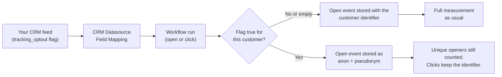

## Before you begin

- Your CRM source feed must expose a consent flag per customer as a boolean column (`true`/`false`), fed from your consent management or preference centre.
- The CRM Datasource must be the one your Workflows use to load the customer context. Customers whose profile is never read by the Workflow keep standard tracking.

## Overview

Some customers do not consent to open tracking. The **Tracking Opt-Out** field type lets a CRM Datasource carry that consent per customer. When the flag is set for a recipient, Reelevant stores their open events under a stable pseudonym instead of their customer identifier.

The pseudonym is a keyed hash of the customer identifier. It is stable per customer, so unique openers are still counted correctly, but it cannot be linked back to the customer record. Clicks are not affected: they keep the customer identifier so click → purchase attribution keeps working.

## How it works

When a Workflow runs for a customer, the Personalisation Engine reads their CRM record — including the flag — to build the personalisation context. That context decides how the open event is stored:

| Flag value | Open event storage | Effect |
|------------|--------------------|--------|
| `true` | Pseudonymous identifier (`anon_…`) | Opens counted in aggregate only; the open cannot be linked back to the customer |
| `false`, empty, or field not mapped | Customer identifier | Standard tracking — the feature is opt-in by default |

Click events are never anonymised. The click keeps the customer identifier and the redirect still carries it to your website, so click → purchase attribution and onsite linking work exactly as before.

<Info>
  Opting out of tracking does not affect personalisation. The customer's CRM record is still read to generate the Content — only what is stored in open events changes.
</Info>

## Configure the flag

1. Add the consent column to your CRM feed, with `true` for customers who opted out of open tracking.
2. Open the CRM Datasource and go to the [Field Mapping](/advanced-guide/datahub/field-mapping) step.
3. Map the column to the **Tracking Opt-Out** (`tracking_opt_out`) field type.
4. Publish the Datasource. New opens honour the flag on the next run; already stored events are unchanged.

Only one column per CRM Datasource can carry the Tracking Opt-Out type. Missing or empty values are treated as opted in — write `true` explicitly for every customer who opted out of open tracking.

## Worked example

A travel brand stores email consent in its CRM. Its `contacts` feed now includes a `tracking_optout` column:

| customer_id | tracking_optout |
|-------------|-----------------|
| C-1042 | false |
| C-2088 | true |

- `C-1042` opens a newsletter → the open event stores `C-1042`; reporting attributes opens and clicks to this customer as usual.
- `C-2088` opens the same newsletter → the open event stores `anon_8f3c…`. They still count as one unique opener, but the platform cannot link the open to `C-2088` or their profile.
- `C-2088` clicks → the click event stores `C-2088` and the redirect carries the tracking identifier, so the click attributes to their purchases like anyone else.

## What it does not do

- **Clicks** — click events keep the customer identifier and the click redirect keeps the tracking identifier, preserving attribution and onsite linking.
- **Personalisation** — opted-out customers still receive personalised Content.
- **Historical events** — previously stored opens keep their original identifier.
- **CRM data** — the customer record itself stays in the Datasource; to remove it, see [Anonymising Customer Records](/advanced-guide/datahub/anonymise-customer-records).
- **Website behaviour** — events collected by the Reelevant web tag are governed by your consent management platform, not by this flag.

For the legal context behind tracking opt-outs, see [How Reelevant Works for DPOs](/why-reelevant/data-protection/overview).
