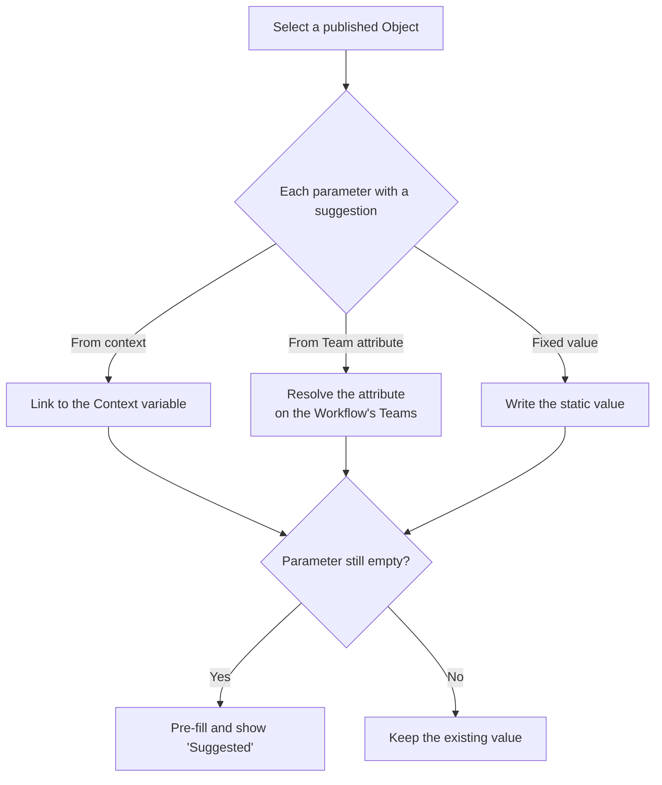

## Overview

The **Datagraph Object** Data Node executes the Live version of a [Datagraph Object](/advanced-guide/datahub/datagraph/entities) and exposes the returned rows to downstream Nodes. It is the only way to consume the Datagraph model inside a Workflow.

Unlike a Datasource Node, which reads a single Datasource, this Node runs the joined SQL prepared in the Object. Filtering, joining, and ordering therefore live in the Object, not in the Node.

<Warning>
  The Datagraph is in beta, and the Node is restricted to tech admins. Other users do not see it in the **Data** menu of the editor.
</Warning>

## Adding the Node

Hover the **Data** button in the editor toolbar and select **Datagraph Object**. See [Data Nodes](/advanced-guide/workflows/data-nodes) for the general procedure.

## Configuration

| Field | Description |
|-------|-------------|
| **Object** | Select an Object from **Select a published object**. Only Objects with a **Live** version appear; a sole Live Object is preselected. |
| **Object parameters** | One field per parameter in the selected Object's Live definition. Each parameter's short description appears above its input. |

The empty selector message is *No published object is available yet.* **Open object in Datahub** opens the Object in a new tab and current account scope.

Changing the selected Object clears the parameter values already set, because parameter names belong to the Object definition.

<Info>
  Publishing a new Object version that renames or adds a parameter does not update Nodes already configured. Re-open each Node to bind the new parameters, otherwise mandatory values are missing at execution time.
</Info>

<Warning>
  Only tech admins can configure Datagraph object query nodes.
</Warning>

<Info>
  The optional **Result limit** field is hidden by default. It appears only when a tech admin enables **Datagraph Object: result limit** in the Workflows settings → **Features** tab.
</Info>

## Binding Parameters

Each parameter is bound either to a static value or to a value produced upstream in the Workflow, through the **Variable Picker**. The input control follows the declared parameter type and shows its short description above the field.

| Parameter type | Control |
|----------------|---------|
| `string`, `id` | Text value or Workflow value |
| `number` | Numeric value or Workflow value |
| `datetime`, `datetime_iso` | Date value or Workflow value |
| `boolean` | Text value or Workflow value |

A parameter takes a single value. Multiple values for one parameter are not supported.

Mandatory parameters must be bound. If a mandatory parameter has no value at execution time, the Object is rejected with an invalid parameter error rather than returning an empty result.

<Info>
  When the Object declares a `client_id` parameter and the Workflow resolves exactly one tracked person, that identifier is used for `client_id` if you left the field empty. Any value you bind explicitly always wins.
</Info>

## Suggested Parameter Values

An Object can declare a suggested value and a list of allowed values per parameter — see [Suggested values](/advanced-guide/datahub/datagraph/entities#suggested-values). When it does, the Node pre-fills the matching inputs.

Pre-fill only applies when you select the Object in the drawer, and only to parameters that are still empty. Values you already set are never overwritten, and an existing Node's parameters are not re-filled when you open it.

| Suggestion source | Pre-filled value |
|-------------------|------------------|
| **From context** | A link to the Context variable in the Context Node. |
| **From Team attribute** | The values resolved on the Workflow's Teams: `string` takes the first value, `string[]` the whole list. A Team without the attribute leaves the parameter empty. |
| **Fixed value** | The declared static value. |

Team attributes are inherited like Team scopes: the closest Team wins per attribute, a Team's list replaces the inherited one, the climb stops at a Team that excludes ancestor inheritance, and two parents at the same level are taken in Team order.

<Info>
  An attribute set on a parent Team is not inherited by a child Team that excludes ancestor inheritance — set it directly on that Team for its Workflows to use it.
</Info>

A pre-filled parameter shows a **Suggested** label. Clicking it clears the value; the label also disappears as soon as you edit the value.

A parameter whose Object declares allowed values gets a select (single value) or a multi-select (list) instead of the Variable Picker. Clearing that select — or clicking **Suggested** — switches the parameter back to the Variable Picker for the rest of the drawer session. A parameter already linked to a variable, or holding a value outside the list, keeps the Variable Picker.

<Info>
  A suggestion only writes a normal parameter value: it changes nothing at execution time.
</Info>

### Example: Team Attributes

Attributes are set per Team in the Team create/edit modal — see [Team attributes](/product-guide/account/teams#team-attributes). Take this Team tree:

- `Europe` (parent) sets `brand = [Acme, Acme Pro]` and `excluded_categories = [outlet, clearance]`.
- `France`, a child of `Europe`, sets no attributes and inherits them.
- `Germany`, a child of `Europe`, excludes ancestor inheritance and has no attributes.
- `Spain`, a child of `Europe`, sets its own `excluded_categories = [outlet]` and inherits the rest.

The Object declares `brand` (`string`, suggestion **From Team attribute** `brand`) and `excluded_categories` (`string[]`, suggestion **From Team attribute** `excluded_categories`). Pre-fill in a Workflow scoped to each Team:

| Workflow's Team | `brand` | `excluded_categories` |
|-----------------|---------|-----------------------|
| `France` | `Acme` (first value of the inherited list) | `outlet`, `clearance` (whole inherited list) |
| `Spain` | `Acme` (inherited) | `outlet` — its own list replaces the inherited one, with no merge |
| `Germany` | stays empty | stays empty — inheritance stops at `Germany`; set the attributes on `Germany` itself |

## Output

The Node returns a list of rows. Each row holds the output columns inferred by the Object, with text, numeric, or empty values.

Those columns are exposed to downstream Nodes in the **Variable Picker**, under the name of the Object, and can feed a [Content](/product-guide/contents/overview) or a [Condition](/advanced-guide/workflows/logic-nodes/conditions).

The canvas Node displays the name of the selected Object, so a Workflow using several Objects stays readable.

## Worked Example

A property listings Datagraph joins users, listings, recommendations, and market prices. The Object `listings_matching_a_user_search` declares one parameter, `user_id`, and returns one row per matching listing with its reference, surface, city, and price.

In the Workflow:

1. A **URL Parameter** Node captures `user_id` from the call made by the sending tool.
2. A **Datagraph Object** Node selects `listings_matching_a_user_search` and binds `user_id` to that URL Parameter. If enabled, set **Result limit** to 6.
3. The Content iterates over the returned rows to build a six-listing block.

Because the joins live in the Object, the same Node configuration works for every recipient, and the model can be corrected without touching the Workflow.

## Operational Notes

- If the **Result limit** field is enabled, keep it aligned with what the Content renders. Rows that are fetched but never displayed still cost execution time.
- Test the Object with **Run query** in the Object editor before wiring it into a Workflow, using the same parameter values.
- Relations with a low join match produce sparse results. Review them in the [Relations tab on the Schema page](/advanced-guide/datahub/datagraph/explorer) before blaming the Node.
- An Object whose Datasources are protected by row-level filters cannot be executed from a Workflow.

## Related

<CardGroup cols={2}>
  <Card title="Datagraph Objects" icon="table" href="/advanced-guide/datahub/datagraph/entities">
    Write the parameterised SQL, infer output columns, and publish an Object.
  </Card>
  <Card title="Datagraph Overview" icon="diagram-project" href="/advanced-guide/datahub/datagraph/overview">
    Understand the model the Objects are built on.
  </Card>
</CardGroup>
