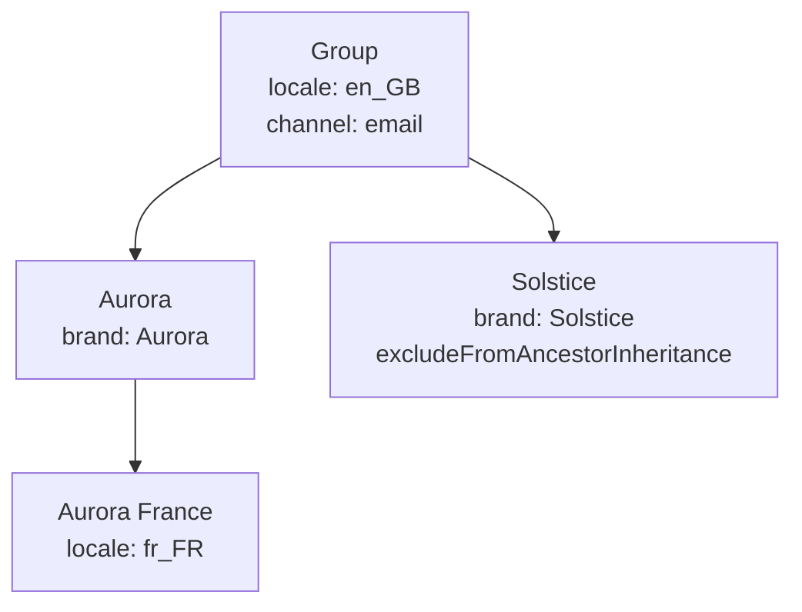

## Overview

A Team (Resource Group) can carry `attributes`: named lists of values such as the brand or the market it manages. Roles then point to an attribute instead of hard-coding the value, so a single "Brand marketer" role filters every user to the brands of their own Teams.

```typescript
const gatewayUrl = process.env.REELEVANT_GATEWAY_URL ?? 'https://api.reelevant.com'
const accessToken = process.env.REELEVANT_ACCESS_TOKEN ?? ''

type TeamAttributeIssue = { path: string; message: string }

export const setTeamAttributes = async (
  teamId: string,
  attributes: Record<string, string[]>,
): Promise<void> => {
  const response = await fetch(`${gatewayUrl}/v2/entities/resource-groups/${teamId}`, {
    method: 'PATCH',
    headers: {
      'Authorization': `Bearer ${accessToken}`,
      'Content-Type': 'application/json',
    },
    body: JSON.stringify({ attributes }),
  })

  if (response.status === 400) {
    const failure = (await response.json()) as {
      error_code?: number
      data?: { issues?: TeamAttributeIssue[] }
    }
    const issues = failure.data?.issues ?? []
    throw new Error(
      `Invalid Team attributes (${failure.error_code ?? 'no error_code'}): ` +
        issues.map(issue => `${issue.path || '<root>'}: ${issue.message}`).join(', '),
    )
  }
  if (!response.ok) {
    throw new Error(`Team update failed: ${response.status} ${await response.text()}`)
  }
}

await setTeamAttributes('6626ef1a2d1f4c0012ab34ce', { brand: ['Aurora'], locale: ['fr_FR'] })
```

The response carries the updated Team:

```json
{
  "status": "success",
  "code": 200,
  "data": {
    "id": "6626ef1a2d1f4c0012ab34ce",
    "companyId": "6626ef1a2d1f4c0012ab34aa",
    "name": "Aurora France",
    "parentIds": ["6626ef1a2d1f4c0012ab34cb"],
    "childrenIds": [],
    "excludeFromAncestorInheritance": false,
    "attributes": { "brand": ["Aurora"], "locale": ["fr_FR"] }
  }
}
```

Writing attributes needs the existing Teams permissions: `create` for `POST`, `update` for `PATCH`. See [Authentication](/developer-docs/api-reference/authentication) to get an access token.

## Writing attributes

`attributes` is accepted by [`POST /v2/entities/resource-groups`](/api-reference/resourcegroup/create-a-resource-group) and [`PATCH /v2/entities/resource-groups/{id}`](/api-reference/resourcegroup/update-a-resource-group).

| Request | Effect |
|---------|--------|
| `attributes` omitted | Attributes are kept unchanged (for example when only `name` is updated). |
| `attributes: { ... }` | The whole map is replaced. Keys missing from the new map are removed. |
| `attributes: {}` | All attributes are removed. |

<Info>
  SCIM provisioning never writes or clears attributes. A Team synced from your identity provider keeps the attributes you set through the API.
</Info>

### Validation

| Rule | Limit |
|------|-------|
| Key format | `^[a-z][a-z0-9_]{0,63}$` (lowercase, starts with a letter) |
| Keys per Team | 20 |
| Values per key | 50, no duplicates |
| Value length | 256 characters |
| Total size | 8192 bytes for the JSON-serialised map |

The total size keeps the identity forwarded between Reelevant services within HTTP header limits. An invalid map returns `400` with `error_code` `5106` and the list of issues:

```json
{
  "status": "fail",
  "code": 400,
  "error_code": 5106,
  "message": "Invalid resource group attributes",
  "data": { "issues": [{ "path": "brand", "message": "Duplicate values are not allowed" }] }
}
```

| Input | `path` | `message` |
|-------|--------|-----------|
| `{ "Brand": ["Aurora"] }` | `Brand` | `Invalid key in record` |
| `{ "brand": ["Aurora", "Aurora"] }` | `brand` | `Duplicate values are not allowed` |
| A 257-character value | `brand.0` | `Too big: expected string to have <=256 characters` |
| 51 values on a key | `brand` | `Too big: expected array to have <=50 items` |
| 21 keys | _empty_ | `At most 20 attributes are allowed` |
| More than 8192 bytes | _empty_ | `Attributes must not exceed 8192 bytes` |

## Inheritance

A Team inherits the attributes of its parent Teams. The effective attributes of a Team are resolved as follows:

- The Team's own keys come first, then those of its parents, then grandparents, following `parentIds`.
- The closest Team wins for each key. A key's list is replaced, never merged with an ancestor's list.
- When two parents at the same distance set the same key, the first one in `parentIds` order wins.
- The climb stops at a Team with `excludeFromAncestorInheritance: true`: its own attributes apply, its ancestors' do not. This is the same rule as for [Team scopes](/product-guide/account/teams#exclude-from-ancestor-inheritance).



| Team | Effective attributes |
|------|----------------------|
| Aurora France | `brand: [Aurora]`, `locale: [fr_FR]`, `channel: [email]` |
| Aurora | `brand: [Aurora]`, `locale: [en_GB]`, `channel: [email]` |
| Solstice | `brand: [Solstice]` |

### Value for a user

A user in several Teams gets, for each key, the union of the effective values of all their Teams. A user in Aurora France and Solstice has `brand: [Aurora, Solstice]`, `locale: [fr_FR]` and `channel: [email]`.

The values are resolved when the access token is checked, so an attribute change applies to the user's next request.

## Using attributes in role conditions

A role rule references an attribute with `{ "$resourceGroupAttribute": "<key>" }`. The reference is resolved to the requesting user's values. Create or update the role with [`POST /v2/entities/roles`](/api-reference/role/create-a-role) or [`PATCH /v2/entities/roles/{id}`](/api-reference/role/update-a-role).

```json
{
  "name": "Brand marketer",
  "rules": [
    {
      "action": "query",
      "subject": "Datasource",
      "mustMatch": ["companyId"],
      "conditions": [
        {
          "type": "datasource_query",
          "options": { "query": { "$and": [{ "brand": { "$eq": { "$resourceGroupAttribute": "brand" } } }] } }
        }
      ]
    },
    {
      "action": "read",
      "subject": "DatagraphEntity",
      "mustMatch": ["companyId"],
      "conditions": [
        {
          "type": "datagraph_option",
          "options": { "option": "brand", "value": { "$resourceGroupAttribute": "brand" } }
        }
      ]
    }
  ]
}
```

### Datasource row filter (`datasource_query`)

On a `query Datasource` rule, the [query filter](/developer-docs/guides/datasource-query-filters) of a `datasource_query` condition can use a reference instead of a static value:

| Condition value | Applied filter for a user with `brand: [Aurora, Solstice]` |
|-----------------|-------------------------------------------------------------|
| `{ "brand": { "$eq": { "$resourceGroupAttribute": "brand" } } }` | `{ "brand": { "$in": ["Aurora", "Solstice"] } }` |
| `{ "brand": { "$in": { "$resourceGroupAttribute": "brand" } } }` | `{ "brand": { "$in": ["Aurora", "Solstice"] } }` |
| `{ "brand": { "$eq": "Aurora" } }` | `{ "brand": { "$eq": "Aurora" } }` (static values are unchanged) |

A user without the attribute gets `$in: []`, so no row matches.

### Object option constraint (`datagraph_option`)

On a `read DatagraphEntity` rule, a `datagraph_option` condition limits which values the user may pass to an Object option when querying it.

| Field | Type | Required | Description |
|-------|------|----------|-------------|
| `type` | `'datagraph_option'` | Yes | Condition type. |
| `options.option` | `string` | Yes | Name of the Object option to constrain. |
| `options.value` | `{ $resourceGroupAttribute: string }` | Yes | Attribute holding the allowed values. |
| `options.entityIds` | `string[]` | No | Objects the condition applies to. Absent or empty applies to every Object. |

The user's query must set the option to one of their values. A user without the attribute has no allowed value. When several conditions apply to the same Object, all of them must be met.

<Info>
  Role conditions apply to requests made by users. Workflow executions by the Runner are not filtered by them.
</Info>

### Validation errors

| Cause | `message` |
|-------|-----------|
| `datagraph_option` on a rule other than `read DatagraphEntity` | `Role validation failed: rules.0.conditions: DatagraphOptionConditionOnlyValidForReadDatagraphEntity` |
| Reference key not matching `^[a-z][a-z0-9_]{0,63}$` | `Role validation failed: rules.0.conditions: InvalidResourceGroupAttributeReference` |
| Reference under an operator other than `$eq` or `$in` | `Role validation failed: rules.0.conditions: InvalidResourceGroupAttributeReference` |

Both return `400`. The index in `rules.0` points to the rejected rule.

## Related

- [Datasource query filters](/developer-docs/guides/datasource-query-filters) — operators accepted in `datasource_query` conditions.
- [Teams](/product-guide/account/teams) — Team hierarchy and ancestor inheritance.
- [Roles](/product-guide/account/roles) — role rules and Team scopes.
- [Authentication](/developer-docs/api-reference/authentication) — getting an access token.
