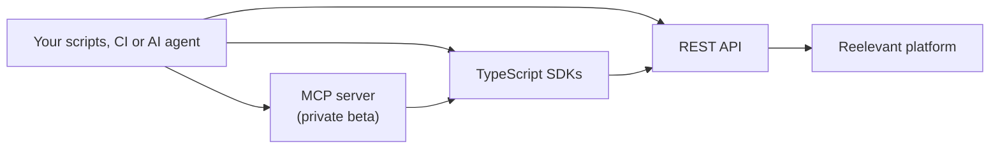

## Overview

The TypeScript SDKs script the Reelevant platform with the same validation as its editors. This lists the Datasources of your account with the Data SDK:

```typescript
import { createClient } from '@reelevant-tech/data-sdk/client'

const data = createClient({
  baseURL: 'https://api.reelevant.com/v2/datasources',
  axios: { headers: { authorization: `Bearer ${process.env.REELEVANT_ACCESS_TOKEN ?? ''}` } },
})

data.datasources
  .list({ perPage: 20 })
  .then(({ items, count }) => {
    console.log(`${count} Datasources`)
    for (const datasource of items) {
      console.log(datasource.id, datasource.name)
    }
  })
  .catch(error => {
    console.error(error)
    process.exit(1)
  })
```

Reelevant exposes the same platform through three layers. Every layer calls the one below it, so you choose how much validation you want to rebuild yourself.



| Layer | What it gives you | Validation | Use it when |
|---|---|---|---|
| REST API | One endpoint per resource, generated from the OpenAPI specs | Payload shape only | You need full control or a language other than TypeScript |
| TypeScript SDKs | The editors' logic as a library: builders, type checking, Datagraph SQL linting, Content rendering | The same checks as the Workflow editor and the Content Editor, before anything is saved | You script changes at scale: one Workflow for every locale, a Datasource synced from CI, a Content checked before publication |
| MCP server | The SDKs exposed as tools, with skills, for AI agents | Same as the SDKs | You let an agent operate the account |

The REST API accepts any payload that matches its schema. A Workflow that references a field missing from its Datasource, or a Branch without an Output Node, is saved and only fails in the Runner. The SDKs load the Datasources and Contents the Workflow uses and reject these changes before they reach the API.

## Packages

| Package | Scope | Guide |
|---|---|---|
| `@reelevant-tech/workflows-sdk` | Load, edit, type check and analyse a Workflow; write a Workflow as TypeScript code | [Workflows SDK](/developer-docs/sdks/workflows-sdk) |
| `@reelevant-tech/data-sdk` | Datasources, Mutable Datasources, Datagraph Schema, Datagraph Objects and Datagraph Object Families | [Data SDK](/developer-docs/sdks/data-sdk) |
| `@reelevant-tech/content-sdk` | Load, edit and render a Content template in the browser or in Node.js | [Content SDK](/developer-docs/sdks/content-sdk) |

All SDKs are written in TypeScript and ship their type declarations. The declarations are the method reference: this section explains the concepts and the main flows, not every method.

## Installation

The SDKs are published on GitHub Packages. Ask your Reelevant contact for read access, then point the `@reelevant-tech` scope to the registry with a GitHub token that has the `read:packages` scope:

```ini .npmrc
@reelevant-tech:registry=https://npm.pkg.github.com
//npm.pkg.github.com/:_authToken=${GITHUB_PACKAGES_TOKEN}
```

```bash
npm install @reelevant-tech/workflows-sdk @reelevant-tech/data-sdk @reelevant-tech/content-sdk
```

Each SDK expects the generated API clients it calls (`@reelevant-tech/*-openapi-client`) as peer dependencies. Install the versions your package manager reports as missing peers, so your code and the SDK share the same client instances.

## Authentication

Every SDK call is authenticated with an access token. For scripts and CI, use a service account and the [client credentials grant](/developer-docs/api-reference/authentication#client-credentials-grant-service-accounts). The token carries the permissions of its user or service account, and the SDKs only see the resources of its Teams (Resource Groups).

| Header | Required | Description |
|---|---|---|
| `authorization` | Yes | `Bearer <access_token>` |
| `x-rlvt-filter-company-id` | No | Company to act on, for a user who has access to several companies. Defaults to the token's own company |

The SDKs accept either configured API clients or an axios configuration, so the header is set once:

```typescript
import DatasourcesApi from '@reelevant-tech/datasources-openapi-client'

const accessToken = process.env.REELEVANT_ACCESS_TOKEN ?? ''

const datasourcesApi = new DatasourcesApi({
  baseURL: 'https://api.reelevant.com/v2/datasources',
  headers: { authorization: `Bearer ${accessToken}` },
})
```

## Errors

The SDKs fail at two levels:

- **Before any request**: invalid input is rejected locally. The Workflows SDK returns a list of `WorkflowError`, the Data SDK throws a `ZodError` or a dedicated validation error, the Content SDK returns the result of `validateTemplate`.
- **On the API**: non-2xx responses are thrown. The Data SDK wraps them in `DatasourcesApiError` (`status`, `errorCode`, `data`); the other SDKs let the axios error through.

Each guide shows how to handle both.

## Related

- [Authentication](/developer-docs/api-reference/authentication)
- [API reference](/developer-docs/api-reference/introduction)
- [Runner failures and debug mode](/developer-docs/guides/runner-failures)
- [Datagraph Schema API](/developer-docs/guides/datagraph-schema-api)
