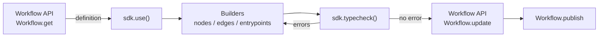

## Overview

`@reelevant-tech/workflows-sdk` is the library the Workflow editor is built on. It holds a Workflow in memory, lets you change it through node builders, and type checks every change against the Datasources and Contents the Workflow uses. The example below adds a `locale` URL parameter to the draft of a Workflow, and saves it only if the result is valid.

```typescript
import ContentsApi from '@reelevant-tech/contents-openapi-client'
import DatasourcesApi from '@reelevant-tech/datasources-openapi-client'
import DatasourcesQueryApi from '@reelevant-tech/datasources-query-openapi-client'
import WorkflowsApi, {
  type BodyForMethod,
  WorkflowVersionState,
} from '@reelevant-tech/workflows-openapi-client'
import { WorkflowsSDK } from '@reelevant-tech/workflows-sdk'

const gatewayUrl = 'https://api.reelevant.com'
const accessToken = process.env.REELEVANT_ACCESS_TOKEN ?? ''
const workflowId = process.env.REELEVANT_WORKFLOW_ID ?? ''

const apis = {
  'datasources': new DatasourcesApi({ baseURL: `${gatewayUrl}/v2/datasources` }),
  'datasources-query': new DatasourcesQueryApi({ baseURL: `${gatewayUrl}/v2/datasources` }),
  'contents': new ContentsApi({ baseURL: `${gatewayUrl}/v2` }),
}
const workflowsApi = new WorkflowsApi({ baseURL: `${gatewayUrl}/v2` })
for (const client of [...Object.values(apis), workflowsApi]) {
  client.axios.defaults.headers.common.authorization = `Bearer ${accessToken}`
}

async function addLocaleParameter(): Promise<void> {
  const { data } = await workflowsApi.Workflow.get({ id: workflowId, versions: [WorkflowVersionState.DRAFT] })
  const draft = data.data.versions.find(version => version.state === WorkflowVersionState.DRAFT)
  if (draft === undefined) {
    throw new Error('The workflow has no draft version')
  }

  const sdk = new WorkflowsSDK(apis)
  await sdk.use(draft.definition)

  const localeParameter = sdk.nodes.builderForNode('url-parameter')
  localeParameter.set('name', 'locale')
  const nodeId = await sdk.nodes.add(localeParameter)

  // Splice the new Node between the first entrypoint and the Node it pointed to
  const [entrypointId] = Object.keys(sdk.workflow.entrypoints)
  const previousTarget = sdk.workflow.edges[entrypointId]?.to
  const batch = sdk.startBatchUpdate()
  sdk.edges.add(entrypointId, nodeId)
  if (previousTarget !== undefined) {
    sdk.edges.add(nodeId, previousTarget)
  }
  batch.end()

  const errors = sdk.typecheck()
  if (errors.length > 0) {
    for (const error of errors) {
      console.error(`Node ${error.id}: ${error.type}`, error.payload)
    }
    throw new Error('The workflow is not valid, nothing was saved')
  }

  await workflowsApi.Workflow.update({ id: workflowId }, {
    definition: sdk.workflow as BodyForMethod<'Workflow', 'update'>['definition'],
  })
  sdk.dispose()
}

addLocaleParameter().catch(error => {
  console.error(error)
  process.exit(1)
})
```

The SDK never saves anything itself. You read a version through the Workflow API, hand its definition to the SDK, and send `sdk.workflow` back through the API once `sdk.typecheck()` returns no error.

## How the SDK works



| Concept | Description |
|---|---|
| Session | One `WorkflowsSDK` instance edits one Workflow definition at a time. `use(definition)` loads it, builds every Node and resolves its dependencies through the API clients. Call `dispose()` when you are done |
| State | `sdk.workflow` is a read-only snapshot of the current definition. `sdk.store` is a reactive store (`{ workflow, errors }`) for UIs that re-render on change |
| Namespaces | Changes go through `sdk.entrypoints`, `sdk.nodes` and `sdk.edges`. Read-only helpers live in `sdk.branches` and `sdk.analyze()` |
| Batches | Every change is committed and type checked on its own. Wrap several changes in `sdk.startBatchUpdate()` and call `end()` (or `abort()`) to commit them as one change. `undo()` and `redo()` walk the same history |
| Data client | `sdk.data` is a [Data SDK](/developer-docs/sdks/data-sdk) client built from the same `datasources` API client |

## Constructor

```typescript
const sdk = new WorkflowsSDK(apis, options)
```

`apis` holds three generated clients, keyed by the API they call:

| Key | Package | Base URL |
|---|---|---|
| `datasources` | `@reelevant-tech/datasources-openapi-client` | `https://api.reelevant.com/v2/datasources` |
| `datasources-query` | `@reelevant-tech/datasources-query-openapi-client` | `https://api.reelevant.com/v2/datasources` |
| `contents` | `@reelevant-tech/contents-openapi-client` | `https://api.reelevant.com/v2` |

The SDK caches successful responses to identical requests for the lifetime of the instance, so loading a large Workflow fetches each Datasource and Content once. Send the `x-rlvt-sdk-no-cache` header on a request to bypass the cache.

| Option | Type | Required | Default | Description |
|---|---|---|---|---|
| `typecheck` | `boolean` | No | `true` | Type check the Workflow after every committed change |
| `hints` | `boolean` | No | `true` | Preload the suggestions of each builder (compatible upstream Nodes, Content templates, option values) when it is created. Turn it off in scripts that already know the values they set |
| `tolerateMissingResources` | `boolean` | No | `false` | Treat a deleted Datasource or Datagraph Object as unconfigured instead of throwing, so a Workflow that still references it can be loaded and repaired |
| `autoRefreshBindings` | `boolean \| object` | No | `false` | Recompute the bindings of the Content Nodes affected by a change (debounced) |
| `automaticExclusions` | `boolean` | No | `false` | Make every `datagraph-query` Node exclude the products already returned by earlier `datagraph-query` Nodes of its Branches |
| `resolveResourceGroupAttributes` | `() => Promise<Record<string, string[]>>` | No | none | Returns the attributes of the Workflow's Teams (Resource Groups), used by `datagraph-query` option suggestions |
| `nodesWhitelist` | `Set<string>` | No | none | Only build these Node ids in `use()`. The other Nodes stay in the definition but are not type checked |
| `compute` | `ComputeOptions` | No | none | Run `analyze()` and Branch computation on a worker instead of the calling thread. Useful in browsers only |

## Node builders

A Node is never written as raw JSON. You ask the SDK for the builder of a Node type, set its options, and add it:

```typescript
const builder = sdk.nodes.builderForNode('url-parameter')
builder.set('name', 'locale')
const nodeId = await sdk.nodes.add(builder)
```

The builder validates each option against the Node's schema and knows which upstream Nodes can feed each property. To change an existing Node, load it into a builder with `await builder.from(nodeId)`, set the new values, then call `sdk.nodes.update(nodeId, builder)`. Removing a Node or an edge leaves dependent Nodes in place and reports them through `typecheck()`, so you decide how to repair them.

| Kind | Node types |
|---|---|
| Data Node | `context`, `url-parameter`, `geolocation`, `weather`, `livepolling`, `transform`, `generic-datasource`, `product-datasource`, `location-datasource`, `datasource-context`, `website-behavior`, `datagraph-query` |
| Logic Node | `condition`, `split`, `experiment`, `realtime-testing` |
| Output Node | `content`, `json`, `json-template`, `text`, `empty` |

Entrypoints (`sdk.entrypoints.add({ type: 'email', format: 'content-image' })`) and edges (`sdk.edges.add(fromId, toId)`) complete the graph. An edge starts from an entrypoint, a Node, or one path of a Logic Node.

## Type checking

`sdk.typecheck()` returns every problem of the current definition as a `WorkflowError`: the Node `id`, the `pathId` for a Logic Node path, the error `type` and a `payload` with the details. An empty list means the Workflow will run as configured.

| `type` | Meaning |
|---|---|
| `invalid_options_property` | A Node option does not match its schema (`payload.path`, `payload.message`) |
| `missing_dependency` | An option references a Node that is missing, or not upstream on a Branch reaching this Node (`payload.branch`) |
| `invalid_dependency_path` | An option reads a field that the upstream Node does not output |
| `invalid_dependency` | An option reads a value whose type does not fit (`payload.expectedType`, `payload.foundType`) |
| `missing_entrypoint` | The Workflow has no entrypoint |
| `missing_output` | A Branch does not end on an Output Node |
| `circular_paths` | A Logic Node path loops back to one of its parents |
| `circular_dependencies` | Two Nodes depend on each other |

Some Node types add their own error types (for example a Datagraph Object that no longer exists). Log `type` and `payload` rather than matching a closed list.

## Saving and publishing

| Call | Effect |
|---|---|
| `Workflow.get({ id, versions: [WorkflowVersionState.DRAFT] })` | Reads the draft version, the one you edit |
| `Workflow.update({ id }, { definition })` | Replaces the draft definition. Fails with `409` if the Workflow does not have exactly one draft |
| `Workflow.publish({ id })` | Makes the draft the live version served by the Runner |

A live version is never modified: every change to production goes through a new draft and a publish.

## Errors

| Source | Shape | Handling |
|---|---|---|
| `sdk.typecheck()` | `WorkflowError[]` | Fix the Nodes listed, or do not save |
| `builder.set()` / `sdk.nodes.add()` | Thrown `Error` | The option value does not match the Node schema |
| `sdk.use()` | Thrown `Error` | A referenced Datasource or Content cannot be loaded. Retry with `tolerateMissingResources: true` to repair the Workflow |
| API clients | axios error | Read `error.response.status` and `error.response.data` |

## Related

- [SDKs overview](/developer-docs/sdks/overview)
- [Data SDK](/developer-docs/sdks/data-sdk)
- [Runner failures and debug mode](/developer-docs/guides/runner-failures)
- [Workflow editor](/product-guide/workflows/editor)
