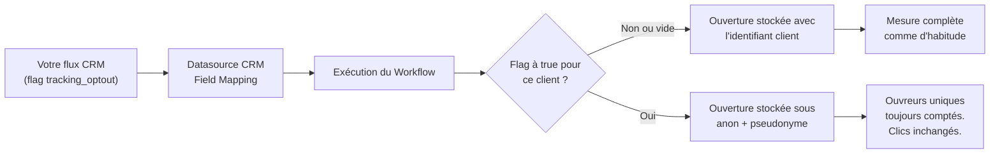

## Avant de commencer

- Votre flux CRM doit exposer un flag de consentement par client sous forme de colonne booléenne (`true`/`false`), alimentée par votre gestion du consentement ou votre centre de préférences.
- La Datasource CRM doit être celle que vos Workflows utilisent pour charger le contexte client. Les clients dont le profil n'est jamais lu par le Workflow conservent le tracking standard.

## Vue d'ensemble

Certains clients ne consentent pas au tracking des ouvertures. Le type de champ **Tracking Opt-Out** permet à une Datasource CRM de transporter ce consentement par client. Quand le flag est activé pour un destinataire, Reelevant stocke ses événements d'ouverture sous un pseudonyme stable plutôt que sous son identifiant client.

Le pseudonyme est un hash à clé de l'identifiant client. Il est stable par client, donc les ouvreurs uniques restent comptés correctement, mais il ne peut pas être relié à la fiche client. Les clics ne sont pas affectés : ils conservent l'identifiant client pour que l'attribution clic → achat continue de fonctionner.

## Fonctionnement

Quand un Workflow s'exécute pour un client, le Personalisation Engine lit sa fiche CRM — dont le flag — pour construire le contexte de personnalisation. Ce contexte détermine comment l'événement d'ouverture est stocké :

| Valeur du flag | Stockage de l'ouverture | Effet |
|----------------|------------------------|-------|
| `true` | Identifiant pseudonyme (`anon_…`) | Ouvertures comptées en agrégé uniquement ; l'ouverture ne peut pas être reliée au client |
| `false`, vide, ou champ non mappé | Identifiant client | Tracking standard — la fonctionnalité est opt-in par défaut |

Les clics ne sont jamais anonymisés. Le clic conserve l'identifiant client et la redirection le transporte toujours vers votre site, donc l'attribution clic → achat et le lien onsite fonctionnent exactement comme avant.

<Info>
  L'opt-out du tracking n'affecte pas la personnalisation. La fiche CRM du client est toujours lue pour générer le Content — seul ce qui est stocké dans les événements d'ouverture change.
</Info>

## Configurer le flag

1. Ajoutez la colonne de consentement à votre flux CRM, avec `true` pour les clients ayant refusé le tracking des ouvertures.
2. Ouvrez la Datasource CRM et allez à l'étape [Field Mapping](/fr/advanced-guide/datahub/field-mapping).
3. Mappez la colonne au type de champ **Tracking Opt-Out** (`tracking_opt_out`).
4. Publiez la Datasource. Les nouvelles ouvertures respectent le flag dès l'exécution suivante ; les événements déjà stockés restent inchangés.

Une seule colonne par Datasource CRM peut porter le type Tracking Opt-Out. Les valeurs manquantes ou vides sont traitées comme un opt-in — écrivez `true` explicitement pour chaque client ayant refusé le tracking des ouvertures.

## Exemple détaillé

Une marque de voyage stocke le consentement email dans son CRM. Son flux `contacts` inclut désormais une colonne `tracking_optout` :

| customer_id | tracking_optout |
|-------------|-----------------|
| C-1042 | false |
| C-2088 | true |

- `C-1042` ouvre une newsletter → l'événement d'ouverture stocke `C-1042` ; le reporting attribue ouvertures et clics à ce client comme d'habitude.
- `C-2088` ouvre la même newsletter → l'événement d'ouverture stocke `anon_8f3c…`. Il compte toujours comme un ouvreur unique dans les rapports, mais la plateforme ne peut pas relier l'ouverture à `C-2088` ni à son profil.
- `C-2088` clique → l'événement de clic stocke `C-2088` et la redirection transporte l'identifiant de tracking, donc le clic est attribué à ses achats comme pour tout le monde.

## Ce que la fonctionnalité ne fait pas

- **Clics** — les événements de clic conservent l'identifiant client et la redirection conserve l'identifiant de tracking, préservant l'attribution et le lien onsite.
- **Personnalisation** — les clients opt-out reçoivent toujours un Content personnalisé.
- **Événements historiques** — les ouvertures déjà stockées conservent leur identifiant d'origine.
- **Données CRM** — la fiche client reste dans la Datasource ; pour la supprimer, voir [Anonymiser des enregistrements clients](/fr/advanced-guide/datahub/anonymise-customer-records).
- **Comportement sur le site** — les événements collectés par le tag web Reelevant relèvent de votre plateforme de gestion du consentement, pas de ce flag.

Pour le contexte juridique des opt-outs de tracking, voir [Comment Reelevant fonctionne pour les DPO](/fr/why-reelevant/data-protection/overview).
