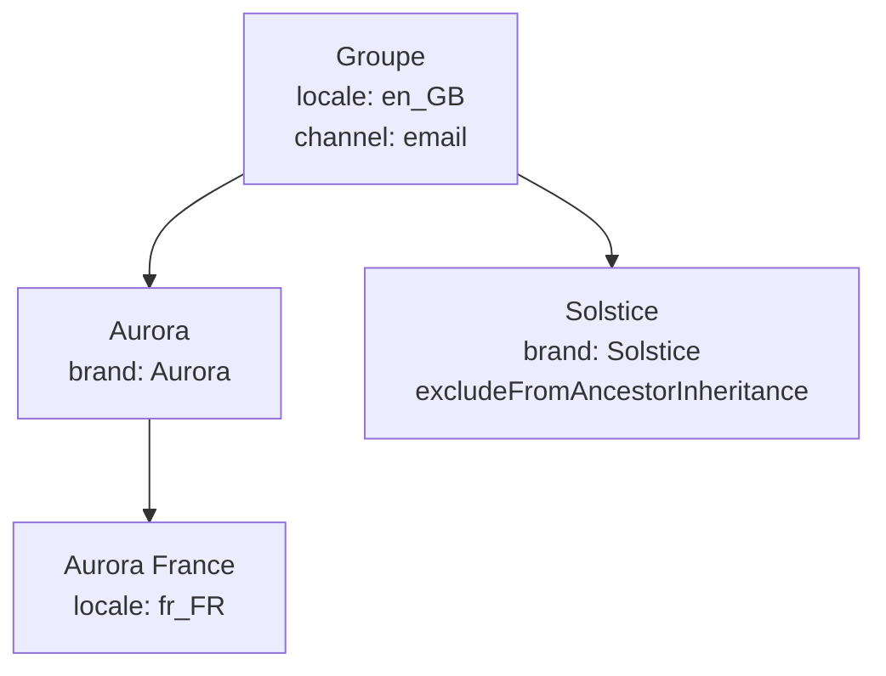

## Vue d'ensemble

Un Team (Resource Group) peut porter des `attributes` : des listes de valeurs nommées, comme la marque ou le marché qu'il gère. Les rôles pointent alors vers un attribut au lieu de coder la valeur en dur : un seul rôle « Brand marketer » filtre chaque utilisateur sur les marques de ses propres Teams.

```typescript
const gatewayUrl = process.env.REELEVANT_GATEWAY_URL ?? 'https://api.reelevant.com'
const accessToken = process.env.REELEVANT_ACCESS_TOKEN ?? ''

type TeamAttributeIssue = { path: string; message: string }

export const setTeamAttributes = async (
  teamId: string,
  attributes: Record<string, string[]>,
): Promise<void> => {
  const response = await fetch(`${gatewayUrl}/v2/entities/resource-groups/${teamId}`, {
    method: 'PATCH',
    headers: {
      'Authorization': `Bearer ${accessToken}`,
      'Content-Type': 'application/json',
    },
    body: JSON.stringify({ attributes }),
  })

  if (response.status === 400) {
    const failure = (await response.json()) as {
      error_code?: number
      data?: { issues?: TeamAttributeIssue[] }
    }
    const issues = failure.data?.issues ?? []
    throw new Error(
      `Invalid Team attributes (${failure.error_code ?? 'no error_code'}): ` +
        issues.map(issue => `${issue.path || '<root>'}: ${issue.message}`).join(', '),
    )
  }
  if (!response.ok) {
    throw new Error(`Team update failed: ${response.status} ${await response.text()}`)
  }
}

await setTeamAttributes('6626ef1a2d1f4c0012ab34ce', { brand: ['Aurora'], locale: ['fr_FR'] })
```

La réponse contient le Team mis à jour :

```json
{
  "status": "success",
  "code": 200,
  "data": {
    "id": "6626ef1a2d1f4c0012ab34ce",
    "companyId": "6626ef1a2d1f4c0012ab34aa",
    "name": "Aurora France",
    "parentIds": ["6626ef1a2d1f4c0012ab34cb"],
    "childrenIds": [],
    "excludeFromAncestorInheritance": false,
    "attributes": { "brand": ["Aurora"], "locale": ["fr_FR"] }
  }
}
```

L'écriture des attributs utilise les permissions existantes sur les Teams : `create` pour `POST`, `update` pour `PATCH`. Consultez [Authentification](/fr/developer-docs/api-reference/authentication) pour obtenir un access token.

## Écrire des attributs

`attributes` est accepté par [`POST /v2/entities/resource-groups`](/api-reference/resourcegroup/create-a-resource-group) et [`PATCH /v2/entities/resource-groups/{id}`](/api-reference/resourcegroup/update-a-resource-group).

| Requête | Effet |
|---------|-------|
| `attributes` absent | Les attributs restent inchangés (par exemple quand seul `name` est modifié). |
| `attributes: { ... }` | Toute la map est remplacée. Les clés absentes de la nouvelle map sont supprimées. |
| `attributes: {}` | Tous les attributs sont supprimés. |

<Info>
  Le provisionnement SCIM n'écrit ni n'efface jamais les attributs. Un Team synchronisé depuis votre fournisseur d'identité conserve les attributs définis via l'API.
</Info>

### Validation

| Règle | Limite |
|-------|--------|
| Format de clé | `^[a-z][a-z0-9_]{0,63}$` (minuscules, commence par une lettre) |
| Clés par Team | 20 |
| Valeurs par clé | 50, sans doublon |
| Longueur d'une valeur | 256 caractères |
| Taille totale | 8192 octets pour la map sérialisée en JSON |

La taille totale garde l'identité transmise entre les services Reelevant sous les limites des en-têtes HTTP. Une map invalide renvoie `400` avec l'`error_code` `5106` et la liste des erreurs :

```json
{
  "status": "fail",
  "code": 400,
  "error_code": 5106,
  "message": "Invalid resource group attributes",
  "data": { "issues": [{ "path": "brand", "message": "Duplicate values are not allowed" }] }
}
```

| Entrée | `path` | `message` |
|--------|--------|-----------|
| `{ "Brand": ["Aurora"] }` | `Brand` | `Invalid key in record` |
| `{ "brand": ["Aurora", "Aurora"] }` | `brand` | `Duplicate values are not allowed` |
| Une valeur de 257 caractères | `brand.0` | `Too big: expected string to have <=256 characters` |
| 51 valeurs sur une clé | `brand` | `Too big: expected array to have <=50 items` |
| 21 clés | _vide_ | `At most 20 attributes are allowed` |
| Plus de 8192 octets | _vide_ | `Attributes must not exceed 8192 bytes` |

## Héritage

Un Team hérite des attributs de ses Teams parents. Les attributs effectifs d'un Team se résolvent ainsi :

- Les clés du Team passent en premier, puis celles de ses parents, puis de ses grands-parents, en suivant `parentIds`.
- Le Team le plus proche l'emporte pour chaque clé. La liste d'une clé est remplacée, jamais fusionnée avec celle d'un ancêtre.
- Quand deux parents à la même distance définissent la même clé, le premier dans l'ordre de `parentIds` l'emporte.
- La remontée s'arrête à un Team avec `excludeFromAncestorInheritance: true` : ses propres attributs s'appliquent, pas ceux de ses ancêtres. C'est la même règle que pour la [portée des Teams](/fr/product-guide/account/teams#exclude-from-ancestor-inheritance).



| Team | Attributs effectifs |
|------|---------------------|
| Aurora France | `brand: [Aurora]`, `locale: [fr_FR]`, `channel: [email]` |
| Aurora | `brand: [Aurora]`, `locale: [en_GB]`, `channel: [email]` |
| Solstice | `brand: [Solstice]` |

### Valeur pour un utilisateur

Un utilisateur membre de plusieurs Teams obtient, pour chaque clé, l'union des valeurs effectives de tous ses Teams. Un utilisateur d'Aurora France et de Solstice a `brand: [Aurora, Solstice]`, `locale: [fr_FR]` et `channel: [email]`.

Les valeurs sont résolues à la vérification de l'access token : une modification d'attribut s'applique à la requête suivante de l'utilisateur.

## Utiliser les attributs dans les conditions de rôle

Une règle de rôle référence un attribut avec `{ "$resourceGroupAttribute": "<clé>" }`. La référence est résolue avec les valeurs de l'utilisateur qui fait la requête. Créez ou modifiez le rôle avec [`POST /v2/entities/roles`](/api-reference/role/create-a-role) ou [`PATCH /v2/entities/roles/{id}`](/api-reference/role/update-a-role).

```json
{
  "name": "Brand marketer",
  "rules": [
    {
      "action": "query",
      "subject": "Datasource",
      "mustMatch": ["companyId"],
      "conditions": [
        {
          "type": "datasource_query",
          "options": { "query": { "$and": [{ "brand": { "$eq": { "$resourceGroupAttribute": "brand" } } }] } }
        }
      ]
    },
    {
      "action": "read",
      "subject": "DatagraphEntity",
      "mustMatch": ["companyId"],
      "conditions": [
        {
          "type": "datagraph_option",
          "options": { "option": "brand", "value": { "$resourceGroupAttribute": "brand" } }
        }
      ]
    }
  ]
}
```

### Filtre de lignes Datasource (`datasource_query`)

Sur une règle `query Datasource`, le [filtre de requête](/fr/developer-docs/guides/datasource-query-filters) d'une condition `datasource_query` peut utiliser une référence au lieu d'une valeur statique :

| Valeur de la condition | Filtre appliqué pour un utilisateur avec `brand: [Aurora, Solstice]` |
|------------------------|-----------------------------------------------------------------------|
| `{ "brand": { "$eq": { "$resourceGroupAttribute": "brand" } } }` | `{ "brand": { "$in": ["Aurora", "Solstice"] } }` |
| `{ "brand": { "$in": { "$resourceGroupAttribute": "brand" } } }` | `{ "brand": { "$in": ["Aurora", "Solstice"] } }` |
| `{ "brand": { "$eq": "Aurora" } }` | `{ "brand": { "$eq": "Aurora" } }` (les valeurs statiques ne changent pas) |

Un utilisateur sans l'attribut obtient `$in: []` : aucune ligne ne correspond.

### Contrainte d'option d'Object (`datagraph_option`)

Sur une règle `read DatagraphEntity`, une condition `datagraph_option` limite les valeurs que l'utilisateur peut passer à une option d'Object lorsqu'il l'interroge.

| Champ | Type | Requis | Description |
|-------|------|--------|-------------|
| `type` | `'datagraph_option'` | Oui | Type de condition. |
| `options.option` | `string` | Oui | Nom de l'option d'Object à contraindre. |
| `options.value` | `{ $resourceGroupAttribute: string }` | Oui | Attribut qui porte les valeurs autorisées. |
| `options.entityIds` | `string[]` | Non | Objects concernés. Absent ou vide : s'applique à tous les Objects. |

La requête de l'utilisateur doit fixer l'option à l'une de ses valeurs. Un utilisateur sans l'attribut n'a aucune valeur autorisée. Quand plusieurs conditions s'appliquent au même Object, toutes doivent être respectées.

<Info>
  Les conditions de rôle s'appliquent aux requêtes des utilisateurs. Les exécutions de Workflow par le Runner ne sont pas filtrées.
</Info>

### Erreurs de validation

| Cause | `message` |
|-------|-----------|
| `datagraph_option` sur une règle autre que `read DatagraphEntity` | `Role validation failed: rules.0.conditions: DatagraphOptionConditionOnlyValidForReadDatagraphEntity` |
| Clé de référence ne respectant pas `^[a-z][a-z0-9_]{0,63}$` | `Role validation failed: rules.0.conditions: InvalidResourceGroupAttributeReference` |
| Référence sous un autre opérateur que `$eq` ou `$in` | `Role validation failed: rules.0.conditions: InvalidResourceGroupAttributeReference` |

Les deux renvoient `400`. L'index dans `rules.0` désigne la règle rejetée.

## Pages associées

- [Filtres de requête Datasource](/fr/developer-docs/guides/datasource-query-filters) — opérateurs acceptés dans les conditions `datasource_query`.
- [Teams](/fr/product-guide/account/teams) — hiérarchie des Teams et héritage des ancêtres.
- [Rôles](/fr/product-guide/account/roles) — règles de rôle et portées de Team.
- [Authentification](/fr/developer-docs/api-reference/authentication) — obtenir un access token.
