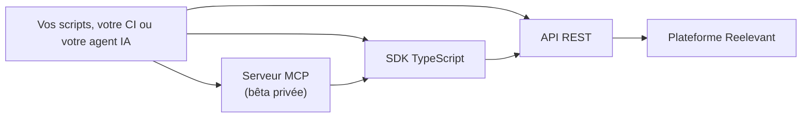

## Vue d'ensemble

Les SDK TypeScript permettent de scripter la plateforme Reelevant avec la même validation que ses éditeurs. Ce script liste les Datasources de votre compte avec le SDK Data :

```typescript
import { createClient } from '@reelevant-tech/data-sdk/client'

const data = createClient({
  baseURL: 'https://api.reelevant.com/v2/datasources',
  axios: { headers: { authorization: `Bearer ${process.env.REELEVANT_ACCESS_TOKEN ?? ''}` } },
})

data.datasources
  .list({ perPage: 20 })
  .then(({ items, count }) => {
    console.log(`${count} Datasources`)
    for (const datasource of items) {
      console.log(datasource.id, datasource.name)
    }
  })
  .catch(error => {
    console.error(error)
    process.exit(1)
  })
```

Reelevant expose la même plateforme à travers trois couches. Chaque couche appelle celle du dessous : vous choisissez la part de validation que vous voulez reconstruire vous-même.



| Couche | Ce qu'elle apporte | Validation | À utiliser quand |
|---|---|---|---|
| API REST | Un endpoint par ressource, généré à partir des spécifications OpenAPI | Forme du payload uniquement | Vous voulez un contrôle total ou un autre langage que TypeScript |
| SDK TypeScript | La logique des éditeurs sous forme de librairie : builders, type checking, lint SQL du Datagraph, rendu des Contents | Les mêmes contrôles que l'éditeur de Workflow et le Content Editor, avant toute sauvegarde | Vous scriptez des changements à l'échelle : un Workflow pour toutes les locales, une Datasource synchronisée depuis la CI, un Content vérifié avant publication |
| Serveur MCP | Les SDK exposés comme outils, avec des skills, pour les agents IA | Identique aux SDK | Vous laissez un agent opérer le compte |

L'API REST accepte tout payload conforme à son schéma. Un Workflow qui référence un champ absent de sa Datasource, ou une Branch sans Output Node, est sauvegardé et n'échoue que dans le Runner. Les SDK chargent les Datasources et les Contents utilisés par le Workflow et rejettent ces changements avant qu'ils n'atteignent l'API.

## Packages

| Package | Périmètre | Guide |
|---|---|---|
| `@reelevant-tech/workflows-sdk` | Charger, modifier, type checker et analyser un Workflow | [SDK Workflows](/fr/developer-docs/sdks/workflows-sdk) |
| `@reelevant-tech/data-sdk` | Datasources, Mutable Datasources, Datagraph Schema, Datagraph Objects et Datagraph Object Families | [SDK Data](/fr/developer-docs/sdks/data-sdk) |
| `@reelevant-tech/content-sdk` | Charger, modifier et rendre un template de Content dans le navigateur ou dans Node.js | [SDK Content](/fr/developer-docs/sdks/content-sdk) |

Tous les SDK sont écrits en TypeScript et fournissent leurs déclarations de types. Ces déclarations servent de référence des méthodes : cette section explique les concepts et les flux principaux, pas chaque méthode.

## Installation

Les SDK sont publiés sur GitHub Packages. Demandez un accès en lecture à votre contact Reelevant, puis faites pointer le scope `@reelevant-tech` vers le registry avec un token GitHub disposant du scope `read:packages` :

```ini .npmrc
@reelevant-tech:registry=https://npm.pkg.github.com
//npm.pkg.github.com/:_authToken=${GITHUB_PACKAGES_TOKEN}
```

```bash
npm install @reelevant-tech/workflows-sdk @reelevant-tech/data-sdk @reelevant-tech/content-sdk
```

Chaque SDK attend les clients d'API générés qu'il appelle (`@reelevant-tech/*-openapi-client`) en peer dependencies. Installez les versions que votre gestionnaire de paquets signale comme manquantes, afin que votre code et le SDK partagent les mêmes instances de client.

## Authentification

Chaque appel des SDK est authentifié par un token d'accès. Pour les scripts et la CI, utilisez un compte de service et le [grant client credentials](/fr/developer-docs/api-reference/authentication#grant-client-credentials-comptes-de-service). Le token porte les permissions de son utilisateur ou de son compte de service : les SDK ne voient que ce que ses rôles et ses Teams (Resource Groups) autorisent.

| Header | Requis | Description |
|---|---|---|
| `authorization` | Oui | `Bearer <access_token>` |
| `x-rlvt-filter-company-id` | Non | Company ciblée, pour un utilisateur ayant accès à plusieurs companies. Par défaut, la company du token |

Les SDK acceptent soit des clients d'API configurés, soit une configuration axios : le header n'est défini qu'une fois.

```typescript
import DatasourcesApi from '@reelevant-tech/datasources-openapi-client'

const accessToken = process.env.REELEVANT_ACCESS_TOKEN ?? ''

const datasourcesApi = new DatasourcesApi({
  baseURL: 'https://api.reelevant.com/v2/datasources',
  headers: { authorization: `Bearer ${accessToken}` },
})
```

## Erreurs

Les SDK échouent à deux niveaux :

- **Avant toute requête** : une entrée invalide est rejetée localement. Le SDK Workflows renvoie une liste de `WorkflowError`, le SDK Data lève une `ZodError` ou une erreur de validation dédiée, le SDK Content renvoie le résultat de `validateTemplate`.
- **Côté API** : les réponses non-2xx sont levées. Le SDK Data les encapsule dans `DatasourcesApiError` (`status`, `errorCode`, `data`) ; les autres SDK laissent passer l'erreur axios.

Chaque guide montre comment gérer les deux.

## Pages associées

- [Authentification](/fr/developer-docs/api-reference/authentication)
- [Référence API](/fr/developer-docs/api-reference/introduction)
- [Échecs du Runner et mode debug](/fr/developer-docs/guides/runner-failures)
- [API Datagraph Schema](/fr/developer-docs/guides/datagraph-schema-api)
