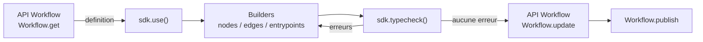

## Vue d'ensemble

`@reelevant-tech/workflows-sdk` est la librairie sur laquelle repose l'éditeur de Workflow. Il garde un Workflow en mémoire, permet de le modifier via des node builders et type checke chaque changement contre les Datasources et les Contents utilisés par le Workflow. L'exemple ci-dessous ajoute un paramètre d'URL `locale` au draft d'un Workflow, et ne le sauvegarde que si le résultat est valide.

```typescript
import ContentsApi from '@reelevant-tech/contents-openapi-client'
import DatasourcesApi from '@reelevant-tech/datasources-openapi-client'
import DatasourcesQueryApi from '@reelevant-tech/datasources-query-openapi-client'
import WorkflowsApi, {
  type BodyForMethod,
  WorkflowVersionState,
} from '@reelevant-tech/workflows-openapi-client'
import { WorkflowsSDK } from '@reelevant-tech/workflows-sdk'

const gatewayUrl = 'https://api.reelevant.com'
const accessToken = process.env.REELEVANT_ACCESS_TOKEN ?? ''
const workflowId = process.env.REELEVANT_WORKFLOW_ID ?? ''

const apis = {
  'datasources': new DatasourcesApi({ baseURL: `${gatewayUrl}/v2/datasources` }),
  'datasources-query': new DatasourcesQueryApi({ baseURL: `${gatewayUrl}/v2/datasources` }),
  'contents': new ContentsApi({ baseURL: `${gatewayUrl}/v2` }),
}
const workflowsApi = new WorkflowsApi({ baseURL: `${gatewayUrl}/v2` })
for (const client of [...Object.values(apis), workflowsApi]) {
  client.axios.defaults.headers.common.authorization = `Bearer ${accessToken}`
}

async function addLocaleParameter(): Promise<void> {
  const { data } = await workflowsApi.Workflow.get({ id: workflowId, versions: [WorkflowVersionState.DRAFT] })
  const draft = data.data.versions.find(version => version.state === WorkflowVersionState.DRAFT)
  if (draft === undefined) {
    throw new Error('The workflow has no draft version')
  }

  const sdk = new WorkflowsSDK(apis)
  await sdk.use(draft.definition)

  const localeParameter = sdk.nodes.builderForNode('url-parameter')
  localeParameter.set('name', 'locale')
  const nodeId = await sdk.nodes.add(localeParameter)

  // Splice the new Node between the first entrypoint and the Node it pointed to
  const [entrypointId] = Object.keys(sdk.workflow.entrypoints)
  const previousTarget = sdk.workflow.edges[entrypointId]?.to
  const batch = sdk.startBatchUpdate()
  sdk.edges.add(entrypointId, nodeId)
  if (previousTarget !== undefined) {
    sdk.edges.add(nodeId, previousTarget)
  }
  batch.end()

  const errors = sdk.typecheck()
  if (errors.length > 0) {
    for (const error of errors) {
      console.error(`Node ${error.id}: ${error.type}`, error.payload)
    }
    throw new Error('The workflow is not valid, nothing was saved')
  }

  await workflowsApi.Workflow.update({ id: workflowId }, {
    definition: sdk.workflow as BodyForMethod<'Workflow', 'update'>['definition'],
  })
  sdk.dispose()
}

addLocaleParameter().catch(error => {
  console.error(error)
  process.exit(1)
})
```

Le SDK ne sauvegarde jamais rien lui-même. Vous lisez une version via l'API Workflow, passez sa définition au SDK, puis renvoyez `sdk.workflow` via l'API une fois que `sdk.typecheck()` ne renvoie plus d'erreur.

## Fonctionnement du SDK



| Concept | Description |
|---|---|
| Session | Une instance `WorkflowsSDK` modifie une définition de Workflow à la fois. `use(definition)` la charge, construit chaque Node et résout ses dépendances via les clients d'API. Appelez `dispose()` quand vous avez terminé |
| État | `sdk.workflow` est un instantané en lecture seule de la définition courante. `sdk.store` est un store réactif (`{ workflow, errors }`) pour les UI qui se mettent à jour à chaque changement |
| Namespaces | Les changements passent par `sdk.entrypoints`, `sdk.nodes` et `sdk.edges`. Les helpers en lecture seule sont dans `sdk.branches` et `sdk.analyze()` |
| Batchs | Chaque changement est commité et type checké séparément. Encadrez plusieurs changements avec `sdk.startBatchUpdate()` et appelez `end()` (ou `abort()`) pour les commiter en un seul. `undo()` et `redo()` parcourent le même historique |
| Client Data | `sdk.data` est un client du [SDK Data](/fr/developer-docs/sdks/data-sdk) construit à partir du même client d'API `datasources` |

## Constructeur

```typescript
const sdk = new WorkflowsSDK(apis, options)
```

`apis` contient trois clients générés, indexés par l'API qu'ils appellent :

| Clé | Package | URL de base |
|---|---|---|
| `datasources` | `@reelevant-tech/datasources-openapi-client` | `https://api.reelevant.com/v2/datasources` |
| `datasources-query` | `@reelevant-tech/datasources-query-openapi-client` | `https://api.reelevant.com/v2/datasources` |
| `contents` | `@reelevant-tech/contents-openapi-client` | `https://api.reelevant.com/v2` |

Le SDK met en cache les réponses réussies aux requêtes identiques pendant la durée de vie de l'instance : charger un gros Workflow ne récupère chaque Datasource et chaque Content qu'une fois. Envoyez le header `x-rlvt-sdk-no-cache` sur une requête pour contourner le cache.

| Option | Type | Requis | Défaut | Description |
|---|---|---|---|---|
| `typecheck` | `boolean` | Non | `true` | Type checker le Workflow après chaque changement commité |
| `hints` | `boolean` | Non | `true` | Précharger les suggestions de chaque builder (Nodes amont compatibles, templates de Content, valeurs d'options) à sa création. Désactivez-la dans les scripts qui connaissent déjà les valeurs qu'ils définissent |
| `tolerateMissingResources` | `boolean` | Non | `false` | Traiter une Datasource ou un Datagraph Object supprimé comme non configuré au lieu de lever une erreur, pour pouvoir charger et réparer un Workflow qui le référence encore |
| `autoRefreshBindings` | `boolean \| object` | Non | `false` | Recalculer (avec debounce) les bindings des Content Nodes touchés par un changement |
| `automaticExclusions` | `boolean` | Non | `false` | Faire exclure à chaque Node `datagraph-query` les produits déjà renvoyés par les Nodes `datagraph-query` précédents de ses Branches |
| `resolveResourceGroupAttributes` | `() => Promise<Record<string, string[]>>` | Non | aucun | Renvoie les attributs des Teams (Resource Groups) du Workflow, utilisés par les suggestions d'options de `datagraph-query` |
| `nodesWhitelist` | `Set<string>` | Non | aucun | Ne construire que ces ids de Node dans `use()`. Les autres Nodes restent dans la définition mais ne sont pas type checkés |
| `compute` | `ComputeOptions` | Non | aucun | Exécuter `analyze()` et le calcul des Branches dans un worker plutôt que dans le thread appelant. Utile dans le navigateur uniquement |

## Node builders

Un Node n'est jamais écrit en JSON brut. Vous demandez au SDK le builder d'un type de Node, définissez ses options, puis l'ajoutez :

```typescript
const builder = sdk.nodes.builderForNode('url-parameter')
builder.set('name', 'locale')
const nodeId = await sdk.nodes.add(builder)
```

Le builder valide chaque option contre le schéma du Node et sait quels Nodes amont peuvent alimenter chaque propriété. Pour modifier un Node existant, chargez-le dans un builder avec `await builder.from(nodeId)`, définissez les nouvelles valeurs, puis appelez `sdk.nodes.update(nodeId, builder)`. Supprimer un Node ou un edge laisse les Nodes dépendants en place et les signale via `typecheck()` : c'est vous qui décidez comment les réparer.

| Catégorie | Types de Node |
|---|---|
| Data Node | `context`, `url-parameter`, `geolocation`, `weather`, `livepolling`, `transform`, `generic-datasource`, `product-datasource`, `location-datasource`, `datasource-context`, `website-behavior`, `datagraph-query` |
| Logic Node | `condition`, `split`, `experiment`, `realtime-testing` |
| Output Node | `content`, `json`, `json-template`, `text`, `empty` |

Les entrypoints (`sdk.entrypoints.add({ type: 'email', format: 'content-image' })`) et les edges (`sdk.edges.add(fromId, toId)`) complètent le graphe. Un edge part d'un entrypoint, d'un Node ou d'un chemin d'un Logic Node.

## Type checking

`sdk.typecheck()` renvoie chaque problème de la définition courante sous forme de `WorkflowError` : l'`id` du Node, le `pathId` pour un chemin de Logic Node, le `type` d'erreur et un `payload` avec le détail. Une liste vide signifie que le Workflow s'exécutera comme configuré.

| `type` | Signification |
|---|---|
| `invalid_options_property` | Une option de Node ne respecte pas son schéma (`payload.path`, `payload.message`) |
| `missing_dependency` | Une option référence un Node absent, ou qui n'est pas en amont sur une Branch menant à ce Node (`payload.branch`) |
| `invalid_dependency_path` | Une option lit un champ que le Node amont ne renvoie pas |
| `invalid_dependency` | Une option lit une valeur dont le type ne convient pas (`payload.expectedType`, `payload.foundType`) |
| `missing_entrypoint` | Le Workflow n'a pas d'entrypoint |
| `missing_output` | Une Branch ne se termine pas sur un Output Node |
| `circular_paths` | Un chemin de Logic Node reboucle sur l'un de ses parents |
| `circular_dependencies` | Deux Nodes dépendent l'un de l'autre |

Certains types de Node ajoutent leurs propres types d'erreur (par exemple un Datagraph Object qui n'existe plus). Journalisez `type` et `payload` plutôt que de comparer à une liste fermée.

## Sauvegarder et publier

| Appel | Effet |
|---|---|
| `Workflow.get({ id, versions: [WorkflowVersionState.DRAFT] })` | Lit la version draft, celle que vous modifiez |
| `Workflow.update({ id }, { definition })` | Remplace la définition du draft. Échoue en `409` si le Workflow n'a pas exactement un draft |
| `Workflow.publish({ id })` | Fait du draft la version live servie par le Runner |

Une version live n'est jamais modifiée : tout changement en production passe par un nouveau draft et une publication.

## Erreurs

| Source | Forme | Traitement |
|---|---|---|
| `sdk.typecheck()` | `WorkflowError[]` | Corrigez les Nodes listés, ou ne sauvegardez pas |
| `builder.set()` / `sdk.nodes.add()` | `Error` levée | La valeur de l'option ne respecte pas le schéma du Node |
| `sdk.use()` | `Error` levée | Une Datasource ou un Content référencé ne peut pas être chargé. Réessayez avec `tolerateMissingResources: true` pour réparer le Workflow |
| Clients d'API | Erreur axios | Lisez `error.response.status` et `error.response.data` |

## Pages associées

- [Vue d'ensemble des SDK](/fr/developer-docs/sdks/overview)
- [SDK Data](/fr/developer-docs/sdks/data-sdk)
- [Échecs du Runner et mode debug](/fr/developer-docs/guides/runner-failures)
- [Éditeur de Workflow](/fr/product-guide/workflows/editor)
