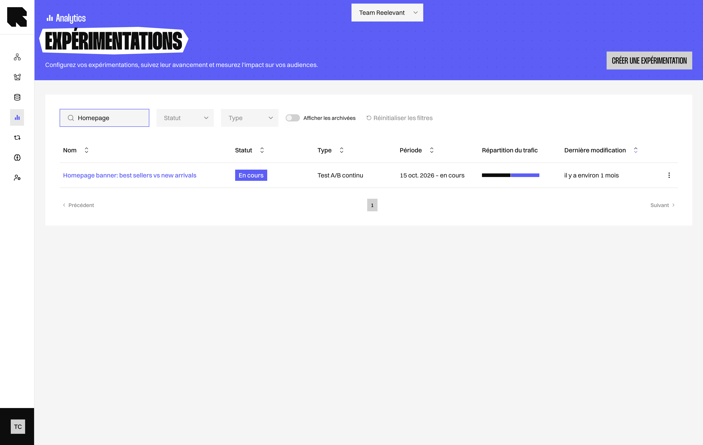
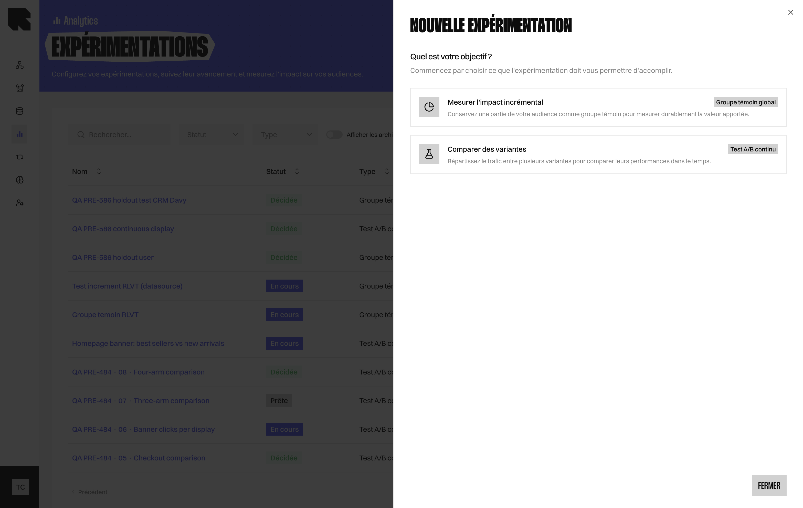
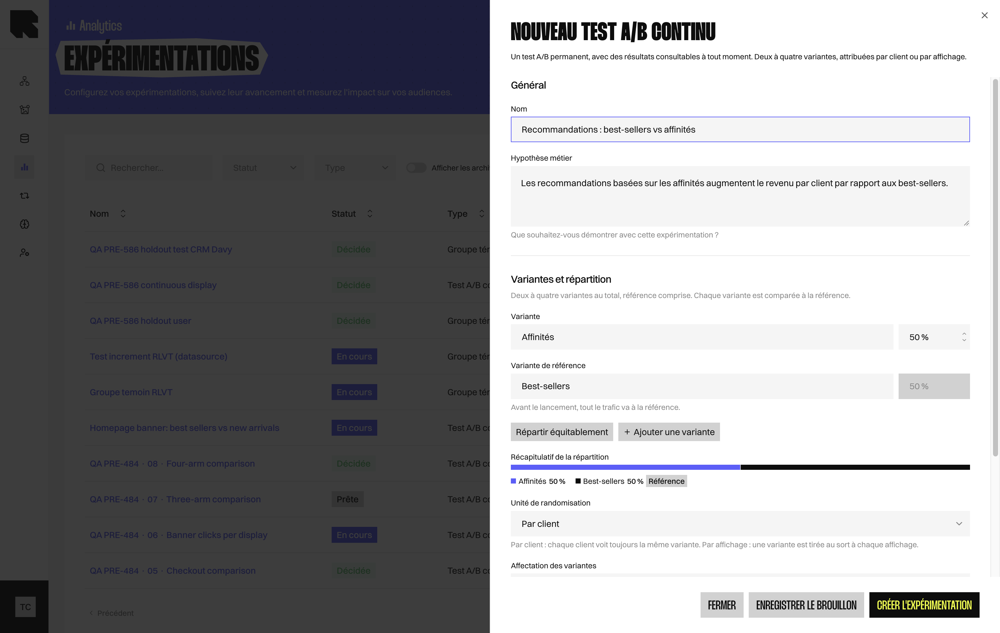
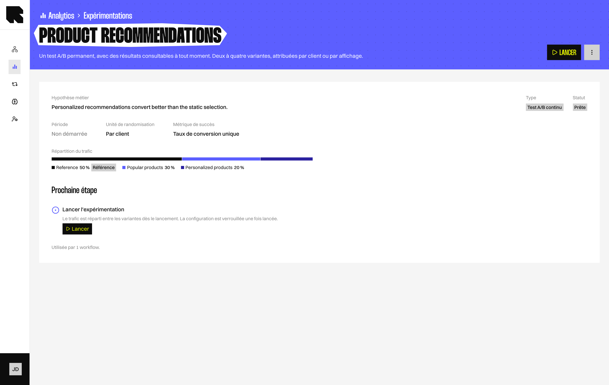
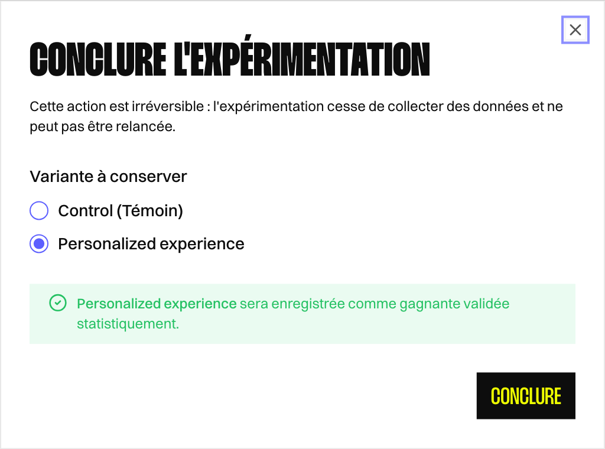

Les expérimentations vous aident à comparer des variantes dans plusieurs Workflows et à mesurer leur impact dans Analytics.

Une expérimentation ([Experiment](/fr/glossary)) se crée et se gère dans Analytics, puis se réutilise dans les Workflows avec le Node Expérimentation. Elle comprend un type, des variantes et leur répartition, une **référence**, une hypothèse métier et une métrique de succès.

## Disponibilité

Les expérimentations sont activées sur demande : contactez votre interlocuteur Reelevant.

## Types d'expérimentation

| Type | Objectif | Variantes | **Unité de randomisation** | Fin |
|------|----------|-----------|------------------------|-----|
| **Groupe témoin global** | **Mesurer l'impact incrémental** | Exactement deux : **référence** et [**traitement**](/fr/glossary) | Toujours **Par client** | Pas de fin automatique ; vous pouvez la conclure manuellement. |
| **Test A/B continu** | **Comparer des variantes** | Deux à quatre, dont une **référence** | **Par client** ou **Par affichage** | Vous la concluez quand vous le souhaitez. |

Un **Groupe témoin global** conserve une partie de votre audience sur l'expérience non personnalisée. Vous pouvez ainsi mesurer la valeur ajoutée par la personnalisation.

## Liste des expérimentations

Ouvrez **Analytics**, puis sélectionnez **Expérimentations** pour consulter vos expérimentations.

| Colonne | Contenu |
|---------|---------|
| **Nom** | Le nom de l'expérimentation. |
| **Statut** | L'étape actuelle de l'expérimentation. |
| **Type** | **Groupe témoin global** ou **Test A/B continu**. |
| **Période** | Les informations de début et de fin. |
| **Répartition du trafic** | La part configurée pour chaque variante. |
| **Dernière modification** | La date de la dernière modification. |

Sélectionnez **Afficher les archivées** pour voir les expérimentations archivées. Sélectionnez **Créer une expérimentation** pour commencer.

## Créer une expérimentation

1. Dans la liste des expérimentations, sélectionnez **Créer une expérimentation**.
2. Sous **Quel est votre objectif ?**, choisissez **Mesurer l'impact incrémental** ou **Comparer des variantes**.
3. Dans **Général**, renseignez le **Nom** et l'**Hypothèse métier**.
4. Dans **Variantes et répartition**, nommez vos variantes, définissez leur répartition et choisissez l'**Unité de randomisation**.
5. Dans **Mesure**, choisissez une **Métrique de succès**.
6. Sélectionnez **Créer l'expérimentation** pour la valider comme **Prête**, ou **Enregistrer le brouillon** pour terminer plus tard.

Dans **Variantes et répartition**, vous pouvez aussi choisir **Depuis une source de données** pour l'**Affectation des variantes**. Consultez [Affecter les variantes depuis une Datasource](/fr/product-guide/analytics/experiments/datasource-assignment).

Le **Nom** ne doit pas correspondre à un tag existant, car l'expérimentation devient un tag.

Sélectionnez **Répartir équitablement** pour répartir le trafic entre les autres variantes. La répartition de la **référence** est calculée automatiquement, pour atteindre 100 % au total.

Avant le démarrage d'un Groupe témoin global, tout le trafic est dirigé vers le **traitement**. Avant le démarrage d'un Test A/B continu, tout le trafic va vers la **référence**.

Choisissez **Par client** pour garder chaque client dans la même variante. Choisissez **Par affichage** pour attribuer une variante à chaque affichage du Content.

Choisissez une **Métrique de succès** : **Taux de conversion unique**, **Taux de clic unique**, **Revenu par client** ou **Achats par client**. Avec **Par affichage**, seul le **Taux de clic unique** est disponible.

<Tip>
  Vous pouvez rattacher une expérimentation **Prête** à un Workflow avant de la lancer. Si aucun Workflow n'utilise l'expérimentation, elle ne reçoit aucun trafic.
</Tip>

## Cycle de vie

| Statut | Signification |
|--------|---------------|
| **Brouillon** | Vous pouvez continuer à modifier l'expérimentation. |
| **Prête** | La configuration est validée et l'expérimentation peut être rattachée à un Workflow. |
| **En cours** | L'expérimentation répartit le trafic. |
| **Décidée** | Une variante a été choisie pour recevoir tout le trafic. **Non validé statistiquement** s'affiche quand la variante conservée n'est pas une gagnante validée, par exemple si vous conservez la référence. |
| **Archivée** | L'expérimentation est archivée et masquée dans la liste active. |

### Valider ou revenir au brouillon

Sélectionnez **Valider la configuration** pour passer un brouillon au statut **Prête**.

Sélectionnez **Repasser en brouillon** pour revenir à l'état Brouillon.

Détachez l'expérimentation de ses Workflows avant de la repasser en brouillon.

Lorsqu'un Workflow utilise une expérimentation **Brouillon** ou **Prête**, vous ne pouvez pas ajouter ni supprimer de variantes. Tout le reste reste modifiable jusqu'à son lancement.

### Lancer

Sélectionnez **Lancer** pour démarrer manuellement l'expérimentation. Le lancement verrouille ses variantes, leur répartition, l'unité de randomisation, la métrique de succès et le mode d'affectation des variantes.

Si aucun Workflow n'utilise l'expérimentation, un avertissement apparaît. Elle ne reçoit aucun trafic tant qu'un Workflow ne l'utilise pas.

### Conclure

La fenêtre **Conclure l'expérimentation** propose des options radio sous **Variante à conserver**. Elle présélectionne une variante selon les résultats.

Choisissez une variante, puis sélectionnez **Conclure**. La fenêtre indique si votre choix sera enregistré comme validé statistiquement.

Tout le trafic est alors dirigé vers cette variante et l'expérimentation devient **Décidée**. Consultez [Conclure avec les résultats](/fr/product-guide/analytics/experiments/results#conclure-avec-les-résultats).

Un **Groupe témoin global** n'a pas de date de fin automatique, mais vous pouvez le conclure manuellement. Vous ne pouvez pas arrêter une expérimentation au statut **En cours** sans choisir une variante à conserver.

<Warning>
  La conclusion est irréversible. L'expérimentation n'inclut plus de nouveaux participants et ne peut pas être relancée.
</Warning>

### Archiver

Sélectionnez **Plus d'actions** > **Archiver**, puis saisissez le mot de confirmation.

<Warning>
  Détachez d'abord l'expérimentation de tous ses Workflows. **Archiver** n'est pas disponible lorsqu'elle est **En cours**.
</Warning>

### Dupliquer

Sélectionnez **Dupliquer** pour créer un brouillon dont le nom se termine par « (copie) ».

## Lire les données d'une expérimentation

Une fois démarrée, la page de l'expérimentation affiche son tableau de bord des résultats. Il montre l'écart de chaque traitement, son intervalle de confiance et sa significativité. Consultez [Analyser les résultats d'une expérimentation](/fr/product-guide/analytics/experiments/results).

Pour détailler davantage les résultats, ouvrez [Data Exploration](/fr/product-guide/analytics/data-exploration). Votre expérimentation apparaît comme un tag portant son nom, avec une valeur par variante.

Ajoutez **Tag: {name}** comme dimension pour comparer les variantes. Consultez [Référence des mesures et dimensions](/fr/product-guide/analytics/measures-and-dimensions) pour choisir les champs. Ces chiffres ne sont pas validés statistiquement.

## Et ensuite ?

<CardGroup cols={3}>
  <Card title="Expérimentation" icon="flask" href="/fr/product-guide/workflows/logic-nodes/experiment">
    Utilisez une expérimentation dans un Workflow.
  </Card>
  <Card title="Analyser les résultats" icon="chart-line" href="/fr/product-guide/analytics/experiments/results">
    Analysez l'écart et la significativité de vos variantes.
  </Card>
  <Card title="Data Exploration" icon="magnifying-glass-chart" href="/fr/product-guide/analytics/data-exploration">
    Explorez vos données analytiques.
  </Card>
</CardGroup>
