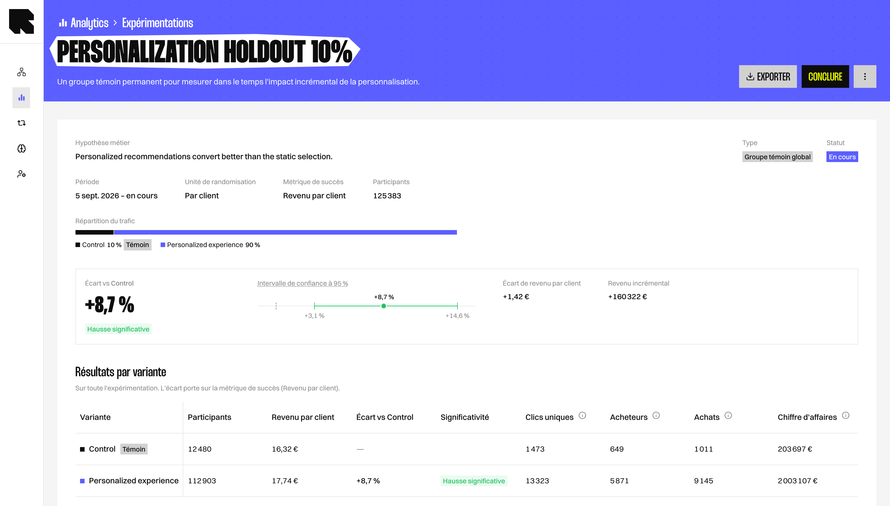
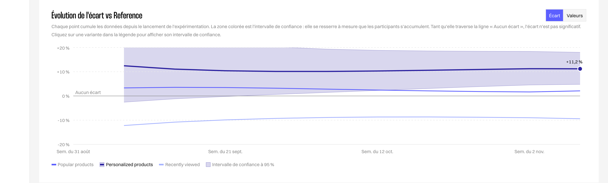
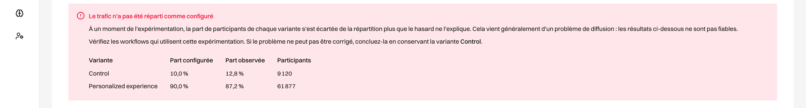
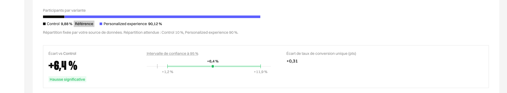

Le tableau de bord des résultats indique si vos [variantes](/fr/glossary) font mieux que la [référence](/fr/glossary), et avec quelle certitude.

## Quand les résultats sont disponibles

Un **Groupe témoin global** ou un **Test A/B continu** affiche ses résultats sur sa page dès qu'il a démarré. Les résultats restent consultables après sa conclusion ou son archivage.

## Le résumé

Le haut de la page rappelle la configuration de l'expérimentation.

| Champ | Ce qu'il affiche |
|-------|------------------|
| **Hypothèse métier** | Ce que l'expérimentation doit démontrer. |
| **Type** et **Statut** | Le type d'expérimentation et son étape dans le cycle de vie. |
| **Période** | Quand l'expérimentation a démarré, et quand elle s'est terminée. |
| **Unité de randomisation** | **Par client** ou **Par affichage**. |
| **Métrique de succès** | La métrique qui sert à juger les variantes. |
| **Participants** | Les clients (ou affichages) exposés à l'expérimentation, toutes variantes confondues. |
| **Répartition du trafic** | La part de trafic configurée pour chaque variante. |

Un participant est un client, ou un affichage avec **Par affichage**, qui a vu une variante. Les clients non inclus, comme les visiteurs anonymes, ne sont jamais comptés.

## L'en-tête des résultats

L'en-tête compare un [traitement](/fr/glossary) (une variante autre que la référence) à la référence, sur la métrique de succès.

### Écart vs référence

**Écart vs** suivi du nom de votre référence affiche l'écart relatif sur la métrique de succès (l'[Uplift](/fr/glossary)). Par exemple, +8,7 % sur **Revenu par client** signifie que les clients du traitement dépensent en moyenne 8,7 % de plus que ceux de la référence.

À côté, un second chiffre donne le même écart dans l'unité de la métrique. Les taux l'affichent en points de pourcentage (pts), comme **Écart de taux de conversion unique (pts)**.

Avec **Revenu par client**, **Revenu incrémental** estime le revenu apporté par le traitement : l'écart par client multiplié par ses participants. Comme l'écart, c'est une estimation : ne vous y fiez que si le traitement est en **Hausse significative**.

### Intervalle de confiance à 95 %

L'**Intervalle de confiance à 95 %** est la plage d'écarts compatible avec les données à ce stade.

L'intervalle se resserre en général à mesure que les participants s'accumulent. Vous pouvez consulter les résultats à tout moment et conclure quand vous le décidez.

### Significativité

| Libellé | Ce qu'il signifie |
|---------|-------------------|
| **Hausse significative** | Tout l'intervalle est au-dessus de 0 : le traitement fait mieux. |
| **Baisse significative** | Tout l'intervalle est en dessous de 0 : le traitement fait moins bien. |
| **Pas encore significatif** | L'intervalle contient encore 0 : les données ne distinguent pas encore ce traitement de la référence. |
| **Pas encore assez de données** | Trop peu d'achats ou de clics pour l'instant. |

### Plusieurs traitements

Dans un Test A/B continu à plusieurs traitements, chaque traitement est comparé à la référence uniquement. Les traitements ne sont jamais comparés entre eux.

Le seuil de significativité est relevé selon le nombre de traitements, pour ne pas trouver un gagnant par hasard.

L'en-tête n'affiche alors que le traitement **En tête** : celui qui a le plus fort écart parmi ceux en **Hausse significative**. Sinon, il indique qu'aucune variante ne fait encore significativement mieux que votre référence.

**En tête** ne signifie pas qu'il fait significativement mieux que les autres traitements.

## Résultats par variante

Le tableau **Résultats par variante** liste toutes les variantes, la référence en premier avec son rôle.

| Colonne | Ce qu'elle affiche |
|---------|--------------------|
| **Participants** | Les participants de cette variante. |
| Métrique de succès | La valeur de la variante sur la métrique de succès, comme **Revenu par client**. |
| **Écart vs** référence | L'écart de la variante sur la métrique de succès. |
| **Significativité** | Le même libellé que dans l'en-tête. |
| **Clics uniques** | Les participants avec au moins un clic. |
| **Acheteurs** | Les participants avec au moins un achat. |
| **Achats** | Les achats faits par les participants. |
| **Chiffre d'affaires** | Le revenu des achats des participants. |

Avec **Par affichage**, le tableau n'affiche que les clics : un affichage ne peut pas être relié à un achat.

### Comment les achats sont comptés

Un achat compte quand un participant le fait après son premier affichage.

Chaque achat compte une fois, en entier. Les retours ne comptent pas comme des achats et ne diminuent pas le revenu, et les achats sans valeur ne sont pas comptés non plus.

Ces chiffres peuvent différer des chiffres attribués de [Data Exploration](/fr/product-guide/analytics/data-exploration).

## Graphique cumulé

Le graphique sous le tableau montre comment les résultats se sont construits dans le temps. Chaque point cumule tous les participants depuis le démarrage.

Basculez entre deux vues :

| Vue | Ce qu'elle affiche |
|-----|--------------------|
| **Écart** (par défaut) | L'écart de chaque traitement, l'**Intervalle de confiance à 95 %** d'un traitement et la ligne **Aucun écart** à 0. |
| **Valeurs** | La valeur de chaque variante sur la métrique de succès, référence comprise. Elle n'affiche pas d'intervalle. |

Dans la vue **Écart**, un écart est significatif tant que sa zone ne croise pas la ligne **Aucun écart**. Avec plusieurs traitements, sélectionnez un traitement dans la légende pour afficher sa zone.

Seuls trois traitements ont leur propre couleur. Les suivants apparaissent en fines lignes grises.

Les points du graphique dépendent de la durée de l'expérimentation :

| Durée de l'expérimentation | Un point par |
|----------------------------|--------------|
| Jusqu'à 1 mois | Jour |
| Jusqu'à 4 mois | Semaine |
| Plus de 4 mois | Mois |

## Le trafic n'a pas été réparti comme configuré

L'expérimentation vérifie que les participants sont répartis entre les variantes comme configuré. Quand la répartition s'écarte plus que le hasard ne l'explique, une alerte rouge apparaît en haut de la page.

Cela signifie généralement que des affichages ont été perdus pour une variante après l'affectation des clients : les résultats ne sont pas fiables.

Quand la répartition est encore faussée, l'alerte affiche la **Part configurée** et la **Part observée** de chaque variante. Les libellés de significativité passent alors en gris, et **En tête** devient **En tête, non fiable**.

La même alerte apparaît quand des participants sont enregistrés sur une variante sans part de trafic. Elle n'affiche alors pas de tableau de parts.

Une fois l'alerte affichée, cette expérimentation ne peut plus être enregistrée comme validée statistiquement, même après correction. Que faire :

1. Cherchez la cause dans les Workflows qui utilisent l'expérimentation. Par exemple, une Branch de variante n'affiche pas toujours de Content, ou une condition suit le Node Expérimentation sur une seule Branch.
2. Concluez l'expérimentation en conservant la référence.
3. Corrigez la cause, puis **Dupliquez** l'expérimentation pour la relancer.

<Note>
  L'alerte reste affichée une fois déclenchée, même si la répartition redevient correcte. Les participants comptés pendant l'écart restent dans les résultats.
</Note>

## Expérimentations qui utilisent une Datasource

Quand les [variantes viennent d'une Datasource](/fr/product-guide/analytics/experiments/datasource-assignment), la Datasource décide de la répartition. Le résumé affiche alors **Participants par variante**, la répartition réellement observée.

La ligne en dessous rappelle votre **Répartition attendue**, celle que vous avez configurée dans votre Datasource. Les clients non classés ne sont pas comptés.

La vérification de la répartition s'applique aussi. Une alerte peut signifier que votre champ ne répartit pas les clients comme configuré. Les conditions ne lui correspondent peut-être pas, ou des clients n'ont pas été servis comme prévu.

En cas d'alerte, vérifiez le champ et les conditions, puis concluez, corrigez et dupliquez comme ci-dessus.

## Exporter en CSV

Sélectionnez **Exporter** en haut de la page de l'expérimentation pour télécharger les résultats au format CSV.

Le fichier contient une ligne par variante pour toute l'expérimentation, puis une ligne par point du graphique et par variante. Les taux sont écrits en fractions : 0.052 signifie 5,2 %.

Si le trafic n'a pas été réparti comme configuré, chaque ligne porte la même alerte que la page.

## Conclure avec les résultats

Quand vous sélectionnez **Conclure**, la fenêtre **Conclure l'expérimentation** présélectionne une variante à conserver. Le premier cas qui s'applique l'emporte :

| Cas | Variante présélectionnée |
|-----|--------------------------|
| Le trafic n'a pas été réparti comme configuré | La référence |
| Un traitement est **En tête** | Ce traitement |
| Groupe témoin global | Le traitement, sauf s'il est en **Baisse significative** |
| Tout autre cas | La référence |

Sous votre choix, la fenêtre indique comment il sera enregistré :

| Message | Quand |
|---------|-------|
| Gagnante validée statistiquement | Le traitement est en **Hausse significative** et le trafic a été réparti comme configuré. |
| Gagnante non validée statistiquement | Tout autre traitement. |
| Décision, sans validation statistique | Vous conservez la référence. |

Si vous choisissez un traitement en **Baisse significative**, un message rouge vous suggère de conserver plutôt la référence.

Le résultat est enregistré au moment de la conclusion et ne change plus ensuite. Une expérimentation **Décidée** non validée affiche **Non validé statistiquement** à côté de son statut.

Si vous conservez un traitement et que ses résultats ne peuvent pas être calculés, l'expérimentation n'est pas conclue et la fenêtre vous l'indique. Réessayez plus tard, ou sélectionnez de nouveau **Conclure** puis confirmez avec **Conclure sans les résultats**.

Avec **Conclure sans les résultats**, votre choix est enregistré comme non validé statistiquement.

<Note>
  Après la conclusion, aucun nouveau participant n'entre. Les achats des participants existants comptent encore 7 jours, et les clics environ une heure. Les chiffres, et même un libellé de significativité, peuvent encore changer, mais le résultat enregistré ne change pas.
</Note>

## Et ensuite ?

<CardGroup cols={3}>
  <Card title="Expérimentations" icon="flask" href="/fr/product-guide/analytics/experiments">
    Créez et gérez des expérimentations dans Analytics.
  </Card>
  <Card title="Affecter les variantes depuis une Datasource" icon="database" href="/fr/product-guide/analytics/experiments/datasource-assignment">
    Utilisez une Datasource CRM pour choisir la variante de chaque client.
  </Card>
  <Card title="Data Exploration" icon="magnifying-glass-chart" href="/fr/product-guide/analytics/data-exploration">
    Détaillez les variantes d'une expérimentation avec d'autres dimensions.
  </Card>
</CardGroup>
