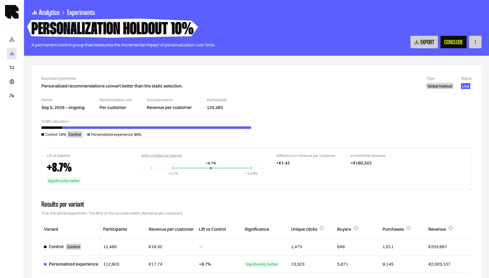
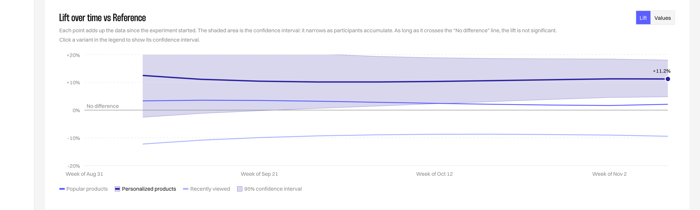
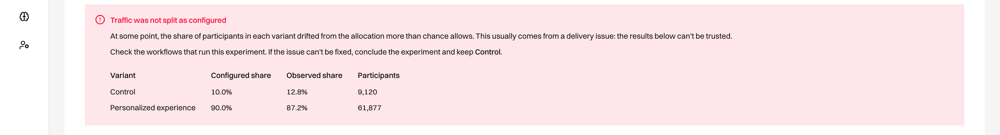
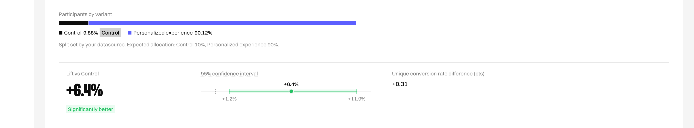
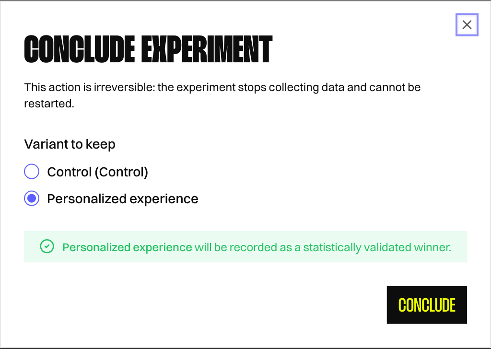

Le tableau de bord des résultats indique si vos variantes font mieux que le [Témoin](/fr/glossary) ou la [Référence](/fr/glossary), et avec quelle certitude.

## Quand les résultats sont disponibles

Un **Groupe témoin global** ou un **Test A/B continu** affiche ses résultats sur sa page dès qu'il a démarré. Les résultats restent consultables après sa conclusion ou son archivage.

Le tableau de bord couvre toujours toute l'expérimentation, depuis son démarrage. Il n'y a pas de filtre de période : choisir une période où les résultats semblent bons les rendrait peu fiables.

Les expérimentations démarrées avant l'arrivée du tableau de bord affichent aussi toutes leurs données. Les données des Nodes Split ou Real-Time Testing ne sont pas incluses.

## Le résumé

Le haut de la page rappelle la configuration de l'expérimentation.

| Champ | Ce qu'il affiche |
|-------|------------------|
| **Hypothèse métier** | Ce que l'expérimentation doit démontrer. |
| **Type** et **Statut** | Le type d'expérimentation et son étape dans le cycle de vie. |
| **Période** | Quand l'expérimentation a démarré, et quand elle s'est terminée. |
| **Unité de randomisation** | **Par client** ou **Par affichage**. |
| **Métrique de succès** | La métrique qui sert à juger les variantes. |
| **Participants** | Les clients (ou affichages) exposés à l'expérimentation, toutes variantes confondues. |
| **Répartition du trafic** | La part de trafic configurée pour chaque variante. |

Un participant est un client, ou un affichage avec **Par affichage**, qui a vu une variante. Les clients non inclus, comme les visiteurs anonymes, ne sont jamais comptés.

## L'en-tête des résultats

L'en-tête compare un Traitement (une variante qui n'est ni le Témoin ni la Référence) au Témoin ou à la Référence, sur la métrique de succès.

### Uplift vs Témoin ou Référence

**Écart vs** suivi du nom de votre Témoin ou de votre Référence affiche l'Uplift (l'écart relatif sur la métrique de succès). Par exemple, +8,7 % sur **Revenu par client** signifie que les clients du Traitement dépensent 8,7 % de plus.

À côté, un second chiffre donne le même écart dans l'unité de la métrique. Les taux l'affichent en points de pourcentage (pts), comme **Écart de taux de conversion unique (pts)**.

Avec **Revenu par client**, **Revenu incrémental** estime le revenu apporté par le Traitement. C'est l'écart par client multiplié par le nombre de participants du Traitement.

### Intervalle de confiance à 95 %

L'**Intervalle de confiance à 95 %** est la plage où se situe très probablement le véritable Uplift. Il se resserre à mesure que les participants s'accumulent.

Vous pouvez consulter les résultats à tout moment, aussi souvent que vous le souhaitez. L'intervalle reste fiable quelle que soit la fréquence de consultation : vous pouvez conclure quand vous le décidez.

<Tip>
  Cet intervalle est plus large que dans un test classique lu une seule fois. Attendez-vous à voir **Pas encore significatif** plus longtemps, surtout avec un petit Témoin.
</Tip>

### Significativité

| Libellé | Ce qu'il signifie |
|---------|-------------------|
| **Hausse significative** | Tout l'intervalle est au-dessus de 0 : le Traitement fait mieux. |
| **Baisse significative** | Tout l'intervalle est en dessous de 0 : le Traitement fait moins bien. |
| **Pas encore significatif** | L'intervalle contient encore 0 : il est trop tôt pour conclure. |
| **Pas encore assez de données** | Trop peu d'achats ou de clics, ou tous les participants ont la même valeur pour l'instant. |

Survolez le libellé pour en voir la raison. Une fois l'expérimentation terminée et ses chiffres figés, les libellés deviennent **Non significatif** et **Pas assez de données**.

### Plusieurs Traitements

Dans un Test A/B continu à plusieurs Traitements, chaque Traitement est comparé à la Référence uniquement. Les Traitements ne sont jamais comparés entre eux.

Le seuil de significativité est relevé selon le nombre de Traitements. Cela évite de trouver un gagnant par hasard, simplement parce que vous comparez plus de variantes.

L'en-tête n'affiche alors que le Traitement **En tête** : celui qui a le plus fort Uplift parmi ceux en **Hausse significative**. Sinon, il indique qu'aucune variante ne fait encore significativement mieux que votre Référence.

## Résultats par variante

Le tableau **Résultats par variante** liste toutes les variantes, le Témoin ou la Référence en premier avec son rôle.

| Colonne | Ce qu'elle affiche |
|---------|--------------------|
| **Participants** | Les participants de cette variante. |
| Métrique de succès | La valeur de la variante sur la métrique de succès, comme **Revenu par client**. |
| **Écart vs** Témoin ou Référence | L'Uplift de la variante sur la métrique de succès. |
| **Significativité** | Le même libellé que dans l'en-tête. |
| **Clics uniques** | Les participants avec au moins un clic. |
| **Acheteurs** | Les participants avec au moins un achat. |
| **Achats** | Les achats faits par les participants. |
| **Chiffre d'affaires** | Le revenu des achats des participants. |

Avec **Par affichage**, le tableau n'affiche que les clics : un affichage ne peut pas être relié à un achat.

### Comment les achats sont comptés

Un achat compte quand un participant le fait après son premier affichage. Il n'y a pas de fenêtre d'attribution (la durée après un clic pendant laquelle un achat lui est crédité).

Chaque achat compte une fois, en entier. Les retours ne comptent pas comme des achats et ne diminuent pas le revenu, et les achats sans valeur ne sont pas comptés non plus.

Ces chiffres peuvent différer des chiffres attribués de [Data Exploration](/fr/product-guide/analytics/data-exploration). La répartition aléatoire indique déjà quelle variante cause un écart : aucun modèle d'attribution n'est nécessaire.

## Graphique cumulé

Le graphique sous le tableau montre comment les résultats se sont construits dans le temps. Chaque point cumule tous les participants depuis le démarrage.

Basculez entre deux vues :

| Vue | Ce qu'elle affiche |
|-----|--------------------|
| **Écart** (par défaut) | L'Uplift de chaque Traitement, l'**Intervalle de confiance à 95 %** d'un Traitement et la ligne **Aucun écart** à 0. |
| **Valeurs** | La valeur de chaque variante sur la métrique de succès, Témoin ou Référence compris. Elle n'affiche pas d'intervalle. |

Dans la vue **Écart**, un Uplift est significatif dès que sa zone ne croise plus la ligne **Aucun écart**. Avec plusieurs Traitements, sélectionnez un Traitement dans la légende pour afficher sa zone.

Seuls trois Traitements ont leur propre couleur. Les suivants apparaissent en fines lignes grises.

Les points du graphique dépendent de la durée de l'expérimentation :

| Durée de l'expérimentation | Un point par |
|----------------------------|--------------|
| Jusqu'à 1 mois | Jour |
| Jusqu'à 4 mois | Semaine |
| Plus de 4 mois | Mois |

Tant que l'expérimentation est en cours, le dernier point n'est pas terminé. Survolez-le pour voir jusqu'à quelle date vont ses données.

## Le trafic n'a pas été réparti comme configuré

L'expérimentation vérifie que les participants sont répartis entre les variantes comme configuré. Quand la répartition s'écarte plus que le hasard ne l'explique, une alerte rouge apparaît en haut de la page.

On parle de déséquilibre de répartition (sample ratio mismatch). Il signifie généralement que des participants n'ont pas été servis ou comptés comme prévu : les résultats ne sont pas fiables.

Quand la répartition est encore faussée, l'alerte affiche la **Part configurée** et la **Part observée** de chaque variante. Les libellés de significativité passent alors en gris, et **En tête** devient **En tête, non fiable**.

Que faire :

1. Vérifiez les Workflows qui utilisent l'expérimentation, par exemple une Branch qui contourne le Node Expérimentation pour certains clients.
2. Si le problème ne peut pas être corrigé, concluez l'expérimentation en conservant le Témoin ou la Référence.
3. Si l'expérimentation est déjà terminée, corrigez le problème avant de relancer une expérimentation similaire.

<Warning>
  L'alerte reste affichée une fois déclenchée, même si la répartition redevient correcte. Les participants comptés pendant l'écart restent dans les résultats.
</Warning>

## Expérimentations qui utilisent une Datasource

Quand les [variantes viennent d'une Datasource](/fr/product-guide/analytics/experiments/datasource-assignment), la Datasource décide de la répartition. Le résumé affiche alors **Participants par variante**, la répartition réellement observée.

La ligne en dessous rappelle votre **Répartition attendue**, celle que vous avez configurée dans votre Datasource. Les clients non classés ne sont pas comptés.

La vérification de la répartition s'applique aussi. Une alerte signifie que votre champ ne répartit pas les clients comme configuré, que les conditions ne lui correspondent pas, ou que ses valeurs n'ont pas été attribuées au hasard.

Dans ce cas, vérifiez le champ de la Datasource et les conditions de chaque variante. Si le problème ne peut pas être corrigé, concluez l'expérimentation en conservant le Témoin ou la Référence.

## Exporter en CSV

Sélectionnez **Exporter** en haut de la page de l'expérimentation pour télécharger les résultats au format CSV.

Le fichier contient une ligne par variante pour toute l'expérimentation, puis une ligne par point du graphique et par variante. Les taux sont écrits en fractions : 0.052 signifie 5,2 %.

Si le trafic n'a pas été réparti comme configuré, chaque ligne porte la même alerte que la page.

## Conclure avec les résultats

Quand vous sélectionnez **Conclure**, la fenêtre **Conclure l'expérimentation** présélectionne une variante à conserver :

- le Traitement **En tête**, s'il y en a un ;
- sinon le Traitement d'un Groupe témoin global, sauf s'il fait significativement moins bien ;
- sinon, ou si le trafic n'a pas été réparti comme configuré, le Témoin ou la Référence.

Sous votre choix, la fenêtre indique comment il sera enregistré :

| Message | Quand |
|---------|-------|
| Enregistrée comme gagnante validée statistiquement | Le Traitement est en **Hausse significative** et le trafic a été réparti comme configuré. |
| Enregistrée comme gagnante non validée statistiquement | Tout autre Traitement. |
| Enregistré comme une décision, sans validation statistique | Vous conservez le Témoin ou la Référence. |

Si vous choisissez un Traitement en **Baisse significative**, un message rouge vous suggère de conserver plutôt le Témoin ou la Référence.

Le résultat est enregistré au moment de la conclusion et ne change plus ensuite. Une expérimentation **Décidée** non validée affiche **Non validé statistiquement** à côté de son statut.

Si les résultats ne peuvent pas être calculés, l'expérimentation n'est pas conclue. Réessayez plus tard, ou sélectionnez **Conclure sans les résultats** : votre choix est alors enregistré comme non validé statistiquement.

<Tip>
  Après la conclusion, les achats continuent d'être comptés pendant 7 jours, et les clics pendant environ une heure. Les chiffres bougent un peu, mais le résultat enregistré ne change pas.
</Tip>

## Pas encore disponible

- Les dates de fin automatiques, avec une lecture automatique des résultats une fois les chiffres figés.
- Les tests A/B à horizon fixe, dimensionnés à l'avance et lus une seule fois.
- Les expérimentations Real-Time Testing et leur tableau de bord.

## Et ensuite ?

<CardGroup cols={3}>
  <Card title="Expérimentations" icon="flask" href="/fr/product-guide/analytics/experiments">
    Créez et gérez des expérimentations dans Analytics.
  </Card>
  <Card title="Affecter les variantes depuis une Datasource" icon="database" href="/fr/product-guide/analytics/experiments/datasource-assignment">
    Utilisez une Datasource CRM pour choisir la variante de chaque client.
  </Card>
  <Card title="Data Exploration" icon="magnifying-glass-chart" href="/fr/product-guide/analytics/data-exploration">
    Détaillez les variantes d'une expérimentation avec d'autres dimensions.
  </Card>
</CardGroup>
