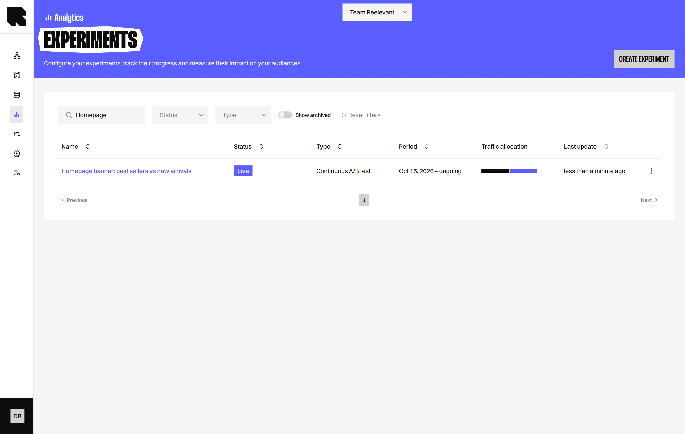
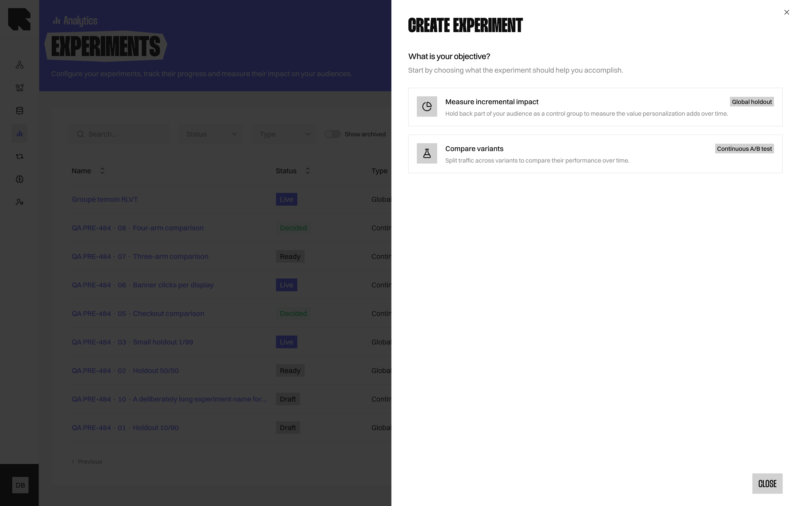
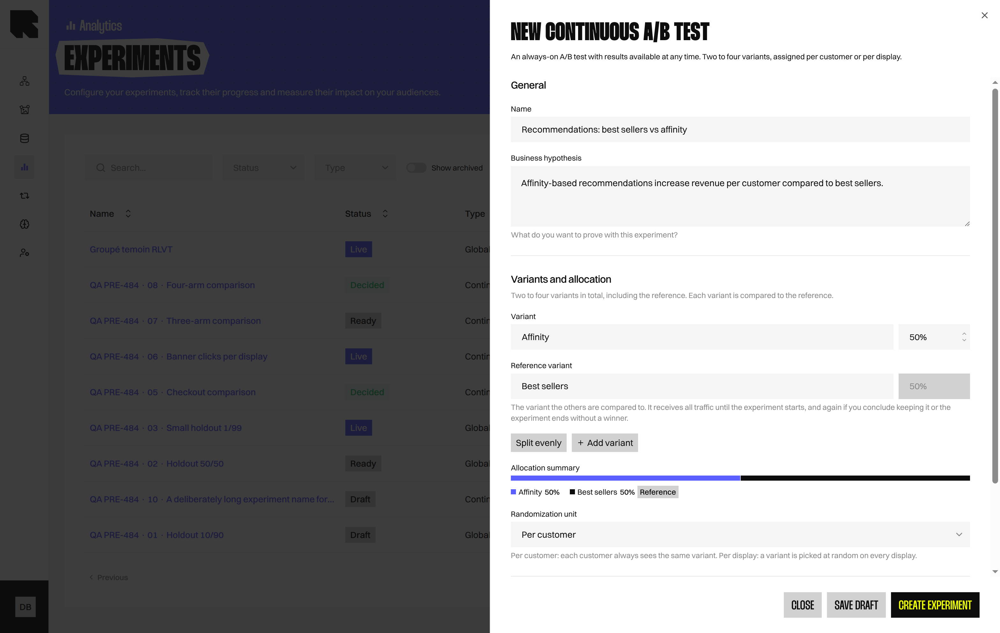
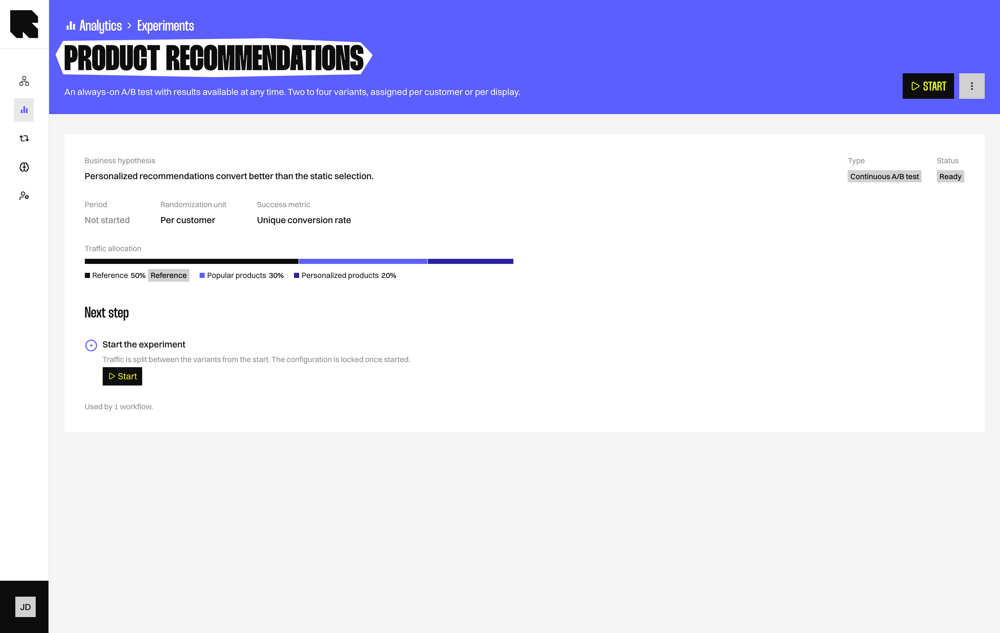
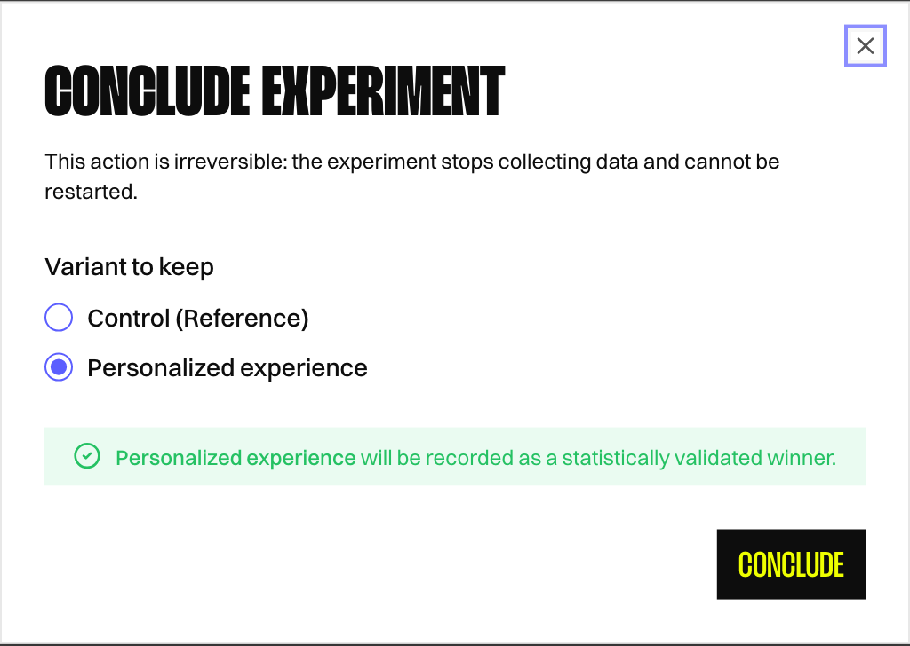

Experiments help you compare variants across Workflows and measure their impact in Analytics.

An [experiment](/glossary) is created and managed in Analytics, then reused by Workflows through the Experiment Node. It has a type, [variants](/glossary), an [allocation](/glossary) for each variant, a [reference](/glossary), a business hypothesis, and a success metric.

## Availability

Experiments are activated on request: contact your Reelevant contact.

## Experiment types

| Type | Objective | Variants | **Randomization unit** | End |
|------|-----------|----------|--------------------|-----|
| **Global holdout** | **Measure incremental impact** | Exactly two: **reference** and [**treatment**](/glossary) | Always **Per customer** | No automatic end; you can conclude it manually. |
| **Continuous A/B test** | **Compare variants** | Two to four, including a **reference** | **Per customer** or **Per display** | Conclude it when you choose. |

A **Global holdout** keeps part of your audience on the non-personalised experience. This helps you measure the value personalisation adds.

## Experiments listing

Open **Analytics** and select **Experiments** to see your experiments.

| Column | What it shows |
|--------|---------------|
| **Name** | The experiment name. |
| **Status** | Where the experiment is in its lifecycle. |
| **Type** | **Global holdout** or **Continuous A/B test**. |
| **Period** | The experiment's start and end information. |
| **Traffic allocation** | The configured share for each variant. |
| **Last update** | When the experiment was last changed. |

Select **Show archived** to include archived experiments. Select **Create experiment** to begin.

## Create an experiment

1. In the experiments listing, select **Create experiment**.
2. Under **What is your objective?**, choose **Measure incremental impact** or **Compare variants**.
3. In **General**, enter a **Name** and **Business hypothesis**.
4. In **Variants and allocation**, name your variants, set their allocation and choose a **Randomization unit**.
5. In **Measurement**, choose one **Success metric**.
6. Select **Create experiment** to validate it as Ready, or **Save draft** to finish later.

In **Variants and allocation**, you can also use a CRM Datasource for **Variant assignment**. See [Assign variants from a Datasource](/product-guide/analytics/experiments/datasource-assignment).

Your **Name** must not match an existing tag name because the experiment becomes a tag.

Select **Split evenly** to divide traffic evenly between the other variants. The **reference** allocation is calculated automatically, keeping the total at 100%.

Before a Global holdout starts, all traffic goes to its **treatment**. Before a Continuous A/B test starts, all traffic goes to its **reference**.

Choose **Per customer** to keep each customer in the same variant. Choose **Per display** to assign a variant each time Content is displayed.

Choose one **Success metric**: **Unique conversion rate**, **Unique click rate**, **Revenue per customer**, or **Purchases per customer**. With **Per display**, only **Unique click rate** is available.

<Tip>
  You can attach a **Ready** experiment to a Workflow before starting it. An experiment used by no Workflow receives no traffic.
</Tip>

## Lifecycle

| Status | What it means |
|--------|---------------|
| **Draft** | You can continue editing the experiment. |
| **Ready** | The configuration is validated and can be attached to a Workflow. |
| **Live** | The experiment is running and allocating traffic. |
| **Decided** | A variant was chosen to receive all traffic. **Not statistically validated** shows when the kept variant is not a validated winner, for example when you keep the reference. |
| **Archived** | The experiment is archived and hidden from the active listing. |

### Validate or return to draft

Select **Validate configuration** to move a draft to Ready.

Select **Back to draft** to return a Ready experiment to Draft.

Detach the experiment from its Workflows before moving it back to Draft.

While a Draft or Ready experiment is used by a Workflow, you cannot add or remove variants. Everything else stays editable until you start it.

### Start

Select **Start** to begin the experiment manually. Starting locks its variants, allocation, Randomization unit, Success metric, and variant assignment method.

If no Workflow uses the experiment, a warning appears. The experiment receives no traffic until a Workflow uses it.

### Conclude

The **Conclude experiment** modal offers **Variant to keep** radio options. It preselects a variant based on the results.

Choose a variant, then select **Conclude**. The modal tells you whether your choice will be recorded as statistically validated.

All traffic then goes to that variant, and the experiment becomes Decided. See [Conclude with results](/product-guide/analytics/experiments/results#conclude-with-results).

A **Global holdout** has no automatic end date, but you can conclude it manually. You cannot stop a **Live** experiment without choosing a variant to keep.

<Warning>
  Concluding is irreversible. The experiment stops enrolling new participants and cannot be restarted.
</Warning>

### Archive

Select **More actions** > **Archive**, then type the confirmation word.

<Warning>
  Detach the experiment from all Workflows first. **Archive** is not available while it is **Live**.
</Warning>

### Clone

Select **Clone** to create a new draft named with “(copy)”.

## Read experiment data

Once started, the experiment page shows its results dashboard: the Uplift of each treatment, its confidence interval, and whether it is significant. See [Analyse Experiment Results](/product-guide/analytics/experiments/results).

To break results down further, open [Data Exploration](/product-guide/analytics/data-exploration). Your experiment appears as a tag named after it, with one value for each variant.

Add **Tag: {name}** as a dimension to compare variants. See [Measures and Dimensions](/product-guide/analytics/measures-and-dimensions) for help choosing fields. These figures are not statistically validated.

## What's Next?

<CardGroup cols={3}>
  <Card title="Experiment Node" icon="flask" href="/product-guide/workflows/logic-nodes/experiment">
    Use an experiment in a Workflow.
  </Card>
  <Card title="Analyse Experiment Results" icon="chart-line" href="/product-guide/analytics/experiments/results">
    Analyse the Uplift and significance of your variants.
  </Card>
  <Card title="Data Exploration" icon="chart-pie" href="/product-guide/analytics/data-exploration">
    Explore your analytics data.
  </Card>
</CardGroup>
