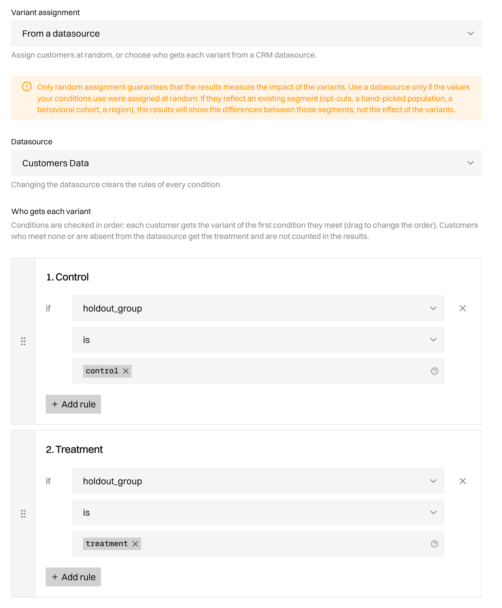

Use a CRM [Datasource](/glossary) to choose each customer's variant in an experiment, instead of a random draw.

A Global holdout (whose [reference variant](/glossary) is a non-personalised control group) or a Continuous A/B test (which compares variants) can use this method.

## When to use it

Choose **From a datasource** when your CRM already splits customers into random groups, such as a holdout shared across channels.

Otherwise, choose **Random assignment (recommended)**. It assigns variants at random and is the standard way to measure their impact.

<Warning>
  Only random assignment guarantees that results measure the impact of the variants. Use a Datasource only when the values your conditions use were assigned at random.

  If they reflect an existing segment, such as opt-outs, hand-picked groups, behavioural cohorts or regions, results show differences between segments. They do not show the effect of the variants.
</Warning>

If other channels also use this field, results measure the combined effect of everything that differs between the groups. This holds only when the other channels do not change who reaches this Workflow.

## Set it up

1. Create an experiment, or edit a **Draft** or **Ready** one, then go to **Variants and allocation**.
2. Keep **Randomization unit** on **Per customer**: a Datasource cannot be used with **Per display**.
3. Under **Variant assignment**, choose **From a datasource**.
4. Under **Datasource**, choose a published CRM Datasource that contains the customer identifier used by your Workflow. This creates one condition per variant. Changing it later clears the rules of every condition.
5. Under **Who gets each variant**, add at least one rule (field, operator, value) to each variant's condition. Combine rules with **and/or**.

## Who gets each variant

Conditions are checked in order, and each customer gets the variant of the first condition they meet. If a customer can meet several conditions, drag the conditions to choose which one comes first.

Each variant's allocation becomes an **Expected allocation**: the split you configured in your Datasource. The Datasource decides who gets each variant, and results check the actual split against it.

A customer is unclassified when they meet no condition, have no row in the Datasource, are anonymous, or their row cannot be read. There is no catch-all condition, so write one condition for every group you want to classify.

Unclassified customers receive a fallback variant and are not counted in the results.

| Experiment type | Fallback variant |
|-----------------|------------------|
| Global holdout | [Treatment](/glossary) |
| Continuous A/B test | [Reference](/glossary) |

The Experiment Node reads the customer's CRM row (their line in the Datasource) itself, so you do not need a [Data Node](/glossary) in the Workflow.

## Example

Your CRM has a field named `holdout_group` that contains `control` or `treatment`, assigned at random. You create a Global holdout and expect 10% of customers in the reference.

| Condition | Variant |
|-----------|---------|
| `holdout_group = control` | Reference |
| `holdout_group = treatment` | Treatment |

A customer whose `holdout_group` is empty meets neither condition. They receive the treatment and are not counted in the results.

The `holdout_group` value decides which variant each customer receives. Results check that about 10% of participants end up in the reference.

## Keep your results reliable

- Use a field whose values were assigned at random and do not change during the experiment.
- Make every group come from the same random draw.
- If you add another rule, add it to every condition with **and**. For example, adding `country = FR` only to the reference condition breaks the comparison.
- Avoid moving classified customers to another variant after start.

## Edit while live

The Datasource, conditions, and their order stay editable until the experiment is concluded. Changes reach new traffic within about a minute.

A customer's variant changes when you edit the conditions or when their CRM values change. In [Data Exploration](/product-guide/analytics/data-exploration), that customer appears under each variant they received, which blurs the difference between variants.

These moves also bias the results when they depend on the variant a customer received. You cannot switch between random and Datasource assignment after start.

## Read the results

Results describe classified customers only. They use the number of customers actually seen in each variant, not the expected allocation.

When statistical significance is shown, a small reference takes longer to reach it.

The Experiment Node shows the same Branches as with random assignment. Once live, its percentages show the expected allocation, not the actual split.

## What's Next?

<CardGroup cols={3}>
  <Card title="Experiments" icon="flask" href="/product-guide/analytics/experiments">
    Create and manage experiments in Analytics.
  </Card>
  <Card title="Experiment Node" icon="flask" href="/product-guide/workflows/logic-nodes/experiment">
    Use an experiment in a Workflow.
  </Card>
  <Card title="Condition Node" icon="code-branch" href="/product-guide/workflows/logic-nodes/conditions">
    Build rules to classify customers.
  </Card>
</CardGroup>
