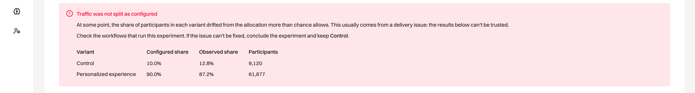

The results dashboard shows whether your [Variants](/glossary) beat the [Control](/glossary) or [Reference](/glossary), and how sure you can be.

## When results are available

A **Global holdout** or a **Continuous A/B test** shows its results on its Experiment page once it has started. Results stay readable after you conclude or archive it.

The dashboard always covers the whole Experiment, from its start.

## The summary

The top of the page recalls how the Experiment is set up.

| Field | What it shows |
|-------|---------------|
| **Business hypothesis** | What the Experiment is meant to prove. |
| **Type** and **Status** | The Experiment type and where it is in its lifecycle. |
| **Period** | When the Experiment started, and when it ended. |
| **Randomization unit** | **Per customer** or **Per display**. |
| **Success metric** | The metric used to judge the Variants. |
| **Participants** | Customers (or displays) the Experiment was shown to, all Variants together. |
| **Traffic allocation** | The share of traffic configured for each Variant. |

A participant is a customer, or a display with **Per display**, who saw a Variant. Customers who were not enrolled, such as anonymous visitors, are never counted.

## The headline

The headline compares a [Treatment](/glossary) (a Variant other than the Control or Reference) with the Control or Reference, on the success metric.

### Uplift vs Control or Reference

**Lift vs** followed by your Control or Reference name shows the Uplift (the relative difference on the success metric). For example, +8.7% on **Revenue per customer** means Treatment customers spend 8.7% more on average than Control customers.

Next to it, a second figure gives the same difference in the metric's own unit. Rates show it in percentage points (pts), such as **Unique conversion rate difference (pts)**.

With **Revenue per customer**, **Incremental revenue** estimates the revenue the Treatment brought in: the difference per customer multiplied by the Treatment's participants. Like the Uplift, it is an estimate: only rely on it when the Treatment is **Significantly better**.

### 95% confidence interval

The **95% confidence interval** is the range of Uplifts the data is consistent with so far. However often you look, it misses the true Uplift at most 5% of the time over the whole Experiment.

The interval usually narrows as participants accumulate. You can check results at any time and conclude whenever you choose.

<Tip>
  This interval is wider than in an experiment read only once, at a set end. Expect **Not yet significant** for longer, especially with a small Control.
</Tip>

### Significance

| Label | What it means |
|-------|---------------|
| **Significantly better** | The whole interval is above 0: the Treatment does better. |
| **Significantly worse** | The whole interval is below 0: the Treatment does worse. |
| **Not yet significant** | The interval still includes 0: the data cannot yet tell this Treatment apart from the Control or Reference. The difference may be too small to detect so far, or there may be none. |
| **Not enough data yet** | Too few purchases or clicks, every participant has the same value so far, or the Control or Reference value is still too uncertain. |

Hover **Not yet significant** or **Not enough data yet** to see why. Once the Experiment has ended and its figures stopped moving, these labels read **Not significant** and **Not enough data**.

**Not significant** does not prove the Variants perform the same: any Uplift inside the interval is still possible.

### Several Treatments

In a Continuous A/B test with several Treatments, each Treatment is compared with the Reference only. Treatments are never compared with each other.

The bar for significance is raised with the number of Treatments, so you do not find a winner by chance just by comparing more Variants. Each Treatment's interval is widened: all intervals together hold at 95%, so each one alone is wider.

The headline then shows only the **Leading** Treatment: the one with the largest Uplift among those **Significantly better**. If none is, it reads "No variant is significantly better than" your Reference "yet".

**Leading** does not mean it does significantly better than the other Treatments. Its Uplift also tends to be on the high side: the interval shows how large it can really be.

## Results per variant

The **Results per variant** table lists every Variant, the Control or Reference first marked with its role.

| Column | What it shows |
|--------|---------------|
| **Participants** | Participants in this Variant. |
| Success metric | The Variant's value on the success metric, such as **Revenue per customer**. |
| **Lift vs** Control or Reference | The Variant's Uplift on the success metric. |
| **Significance** | The same label as in the headline. |
| **Unique clicks** | Participants with at least one click. |
| **Buyers** | Participants with at least one purchase. |
| **Purchases** | Purchases made by the participants. |
| **Revenue** | Revenue of the participants' purchases. |

With **Per display**, the table shows clicks only, since a display cannot be linked to a purchase.

### How purchases are counted

A purchase counts when a participant makes it after their first display. There is no attribution window (the time after a click during which a purchase is credited).

Each purchase counts once and in full. Returns are not counted as purchases and do not lower revenue, and purchases with no value are not counted either.

These figures can differ from the attributed figures in [Data Exploration](/product-guide/analytics/data-exploration). The random split already tells which Variant caused a difference, so no attribution model is needed.

A participant's purchases keep adding up while the Experiment runs. Right after many new participants arrive, they have had little time to buy. The Uplift then moves toward 0 for a while, for every Variant alike.

## Cumulative chart

The chart under the table shows how results built up over time. Each point adds up every participant since the start.

Switch between two views:

| View | What it shows |
|------|---------------|
| **Lift** (default) | Each Treatment's Uplift, the **95% confidence interval** of one Treatment, and the **No difference** line at 0. |
| **Values** | Each Variant's value on the success metric, Control or Reference included. It shows no interval. |

In the **Lift** view, an Uplift is significant while its band does not cross the **No difference** line. With several Treatments, select a Treatment in the legend to show its band.

Only three Treatments get their own colour. Others appear as thin grey lines.

The chart's points follow the Experiment's length:

| Experiment length | One point per |
|-------------------|---------------|
| Up to 1 month | Day |
| Up to 4 months | Week |
| More than 4 months | Month |

Until the figures stop moving, the last point is still in progress. Hover it to see the date its data runs to.

## Traffic was not split as configured

The Experiment checks that participants are split between Variants as configured. When the split drifts more than chance allows, a red warning appears at the top of the page.

This is called a sample ratio mismatch. It usually means displays were lost for one Variant after customers were assigned, so the results cannot be trusted.

When the split is still off, the warning shows each Variant's **Configured share** and **Observed share**. While it shows, significance labels are greyed out, and **Leading** reads **Leading, unreliable**.

The same warning appears when participants are recorded on a Variant with no traffic share. It then shows no share table.

Once this warning shows, this Experiment can no longer be recorded as statistically validated, even after a fix. What to do:

1. Find the cause in the Workflows that run the Experiment. For example, a Variant's Branch does not always show a Content, or a condition follows the Experiment Node on one Branch only.
2. Conclude the Experiment and keep the Control or Reference.
3. Fix the cause, then **Clone** the Experiment to run it again.

<Note>
  The warning stays once raised, even if the split looks right again later. Participants counted while it drifted are still in the results.
</Note>

## Experiments that use a Datasource

When [Variants come from a Datasource](/product-guide/analytics/experiments/datasource-assignment), the Datasource decides the split. The summary then shows **Participants by variant**, the split actually observed.

The line under it recalls your **Expected allocation**, the split you configured from your Datasource. Unclassified customers are not counted.

The split check also applies. A warning can mean your field does not split customers as configured, or the conditions do not match it. Some customers may also not have been delivered as planned.

A check that passes does not prove the values were assigned at random. If the warning shows, check the Datasource field and the conditions, then conclude, fix and **Clone** as above.

## Export to CSV

Select **Export** at the top of the Experiment page to download the results as a CSV file.

The file has one row per Variant for the whole Experiment, then one row per chart point and Variant. Rates are written as fractions, so 0.052 means 5.2%.

If traffic was not split as configured, every row carries the same warning as the page.

## Conclude with results

When you select **Conclude**, the **Conclude experiment** modal preselects a Variant to keep. The first case that matches wins:

| Case | Preselected Variant |
|------|---------------------|
| Traffic was not split as configured | The Control or Reference |
| A Treatment is **Leading** | That Treatment |
| Global holdout | The Treatment, unless it is **Significantly worse** |
| Any other case | The Control or Reference |

Under your choice, the modal tells you how it will be recorded:

| Message | When |
|---------|------|
| Recorded as a statistically validated winner | The Treatment is **Significantly better** and traffic was split as configured. |
| Recorded as a winner that is not statistically validated | Any other Treatment. |
| Recorded as a decision rather than a statistically validated win | You keep the Control or Reference. |

If you pick a Treatment that is **Significantly worse**, a red message suggests keeping the Control or Reference instead.

The outcome is recorded when you conclude and never changes afterwards. A Decided Experiment that is not validated shows **Not statistically validated** next to its status.

If you keep a Treatment and its results cannot be computed, the Experiment is not concluded and the modal tells you so. Try again later, or select **Conclude** again and confirm with **Conclude without results**.

With **Conclude without results**, your choice is recorded as not statistically validated.

<Note>
  After you conclude, no new participants join. Purchases by existing participants keep counting for 7 days, and clicks for about an hour. The figures, and even a significance label, can still change, but the recorded outcome does not.
</Note>

## What's Next?

<CardGroup cols={3}>
  <Card title="Experiments" icon="flask" href="/product-guide/analytics/experiments">
    Create and manage Experiments in Analytics.
  </Card>
  <Card title="Assign Variants from a Datasource" icon="database" href="/product-guide/analytics/experiments/datasource-assignment">
    Use a CRM Datasource to choose each customer's Variant.
  </Card>
  <Card title="Data Exploration" icon="chart-pie" href="/product-guide/analytics/data-exploration">
    Break down an Experiment's Variants with other dimensions.
  </Card>
</CardGroup>
