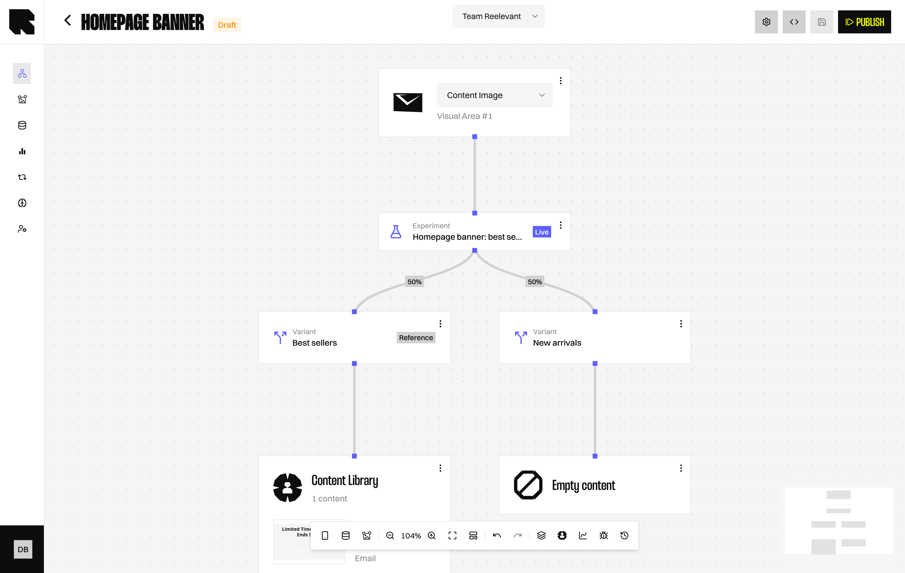
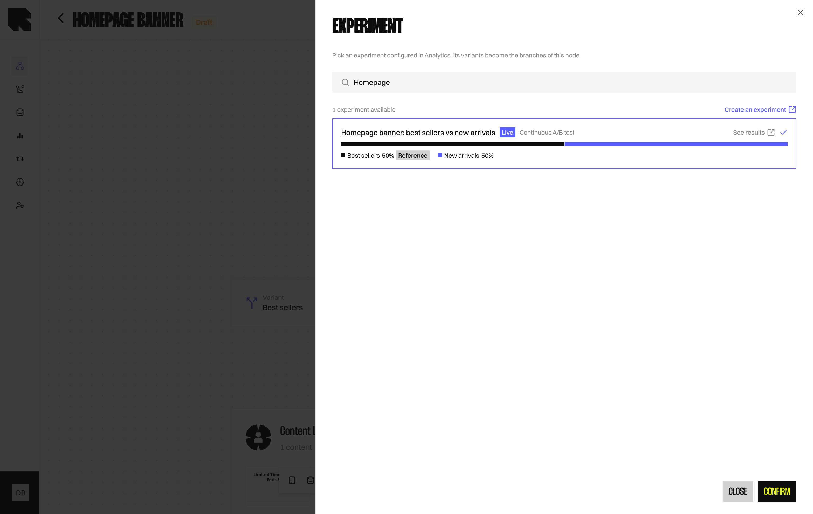

Use the Experiment Node (a Logic Node that divides traffic) to turn an Analytics experiment's variants into Workflow Branches. Each variant becomes a **Variant** Node (a Branch) showing the share of traffic it receives right now.

Before the experiment starts, the treatment of a Global holdout or the reference of a Continuous A/B test shows 100%.

## Add an Experiment Node

1. In the Workflow Node picker, select **Experiment**.
2. Search for a **Ready** or **Live** experiment and select its card.
3. Select **Confirm** to add the Experiment Node.

Only **Ready** and **Live** experiments are listed. If none is available, use **Create an experiment** to open Analytics.

<Tip>
  If publishing reports a variant problem on this Node, reopen it and select the experiment again. Its Branches are rebuilt from the experiment's variants.
</Tip>

## After an experiment is concluded

The kept variant shows **Winner**, and the Node routes all traffic to it.

An experiment that has ended stays on the Node and keeps routing to its outcome. You cannot pick it for a new Node.

If the experiment is archived or missing, the Node shows **Experiment unavailable**. It sends all traffic to the **treatment** of a Global holdout or the **reference** of a Continuous A/B test. If the experiment had already ended when the Workflow was last published, it sends traffic to the kept variant instead.

## What's Next?

<CardGroup cols={3}>
  <Card title="Experiments" icon="flask" href="/product-guide/analytics/experiments">
    Create and manage experiments in Analytics.
  </Card>
  <Card title="Split" icon="chart-pie" href="/product-guide/workflows/logic-nodes/split">
    Divide traffic between Workflow Branches.
  </Card>
  <Card title="Real-Time Testing" icon="flask" href="/product-guide/workflows/logic-nodes/real-time-testing">
    Optimise traffic across variants automatically.
  </Card>
</CardGroup>
